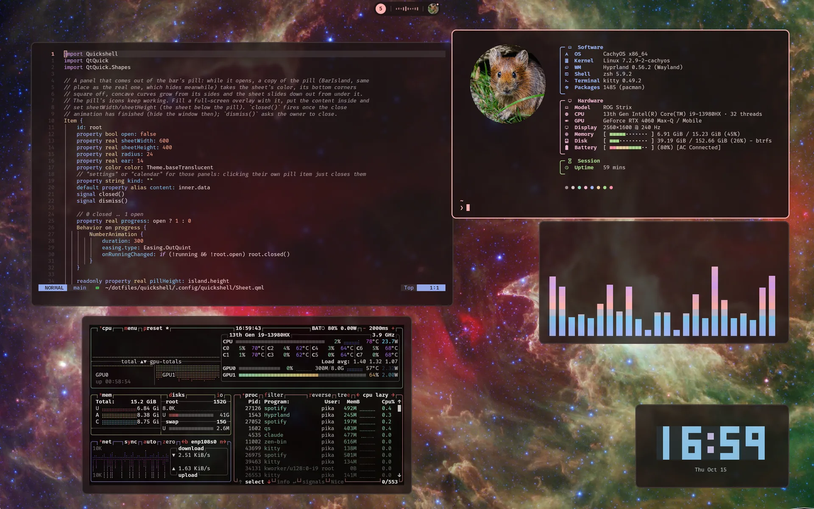
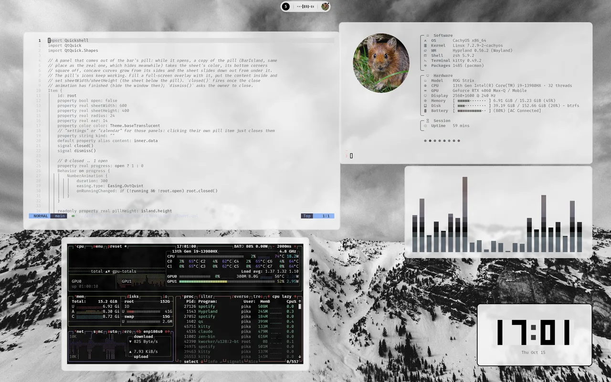
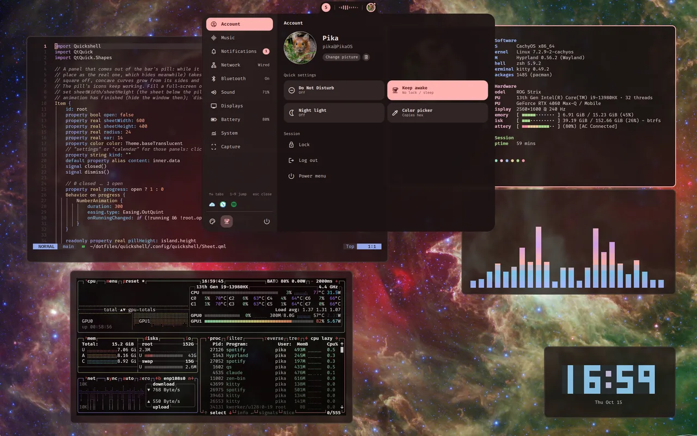
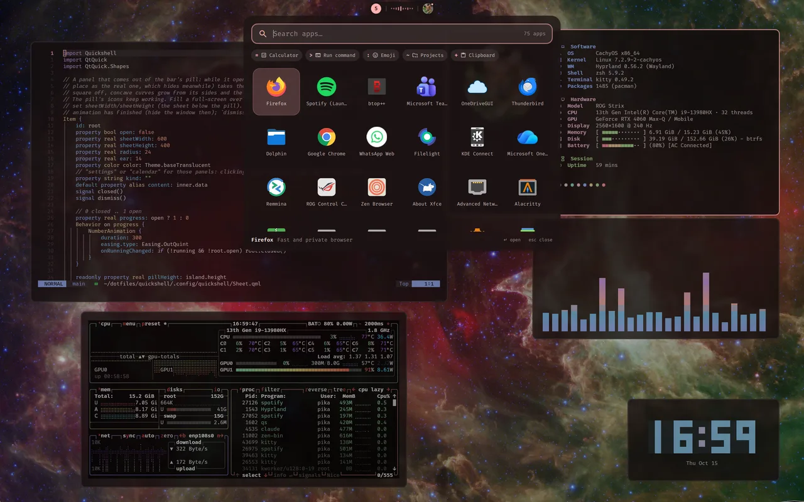
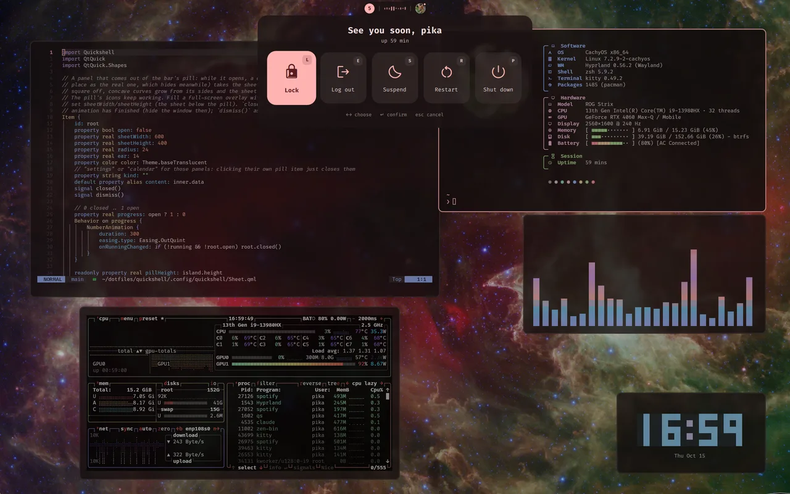
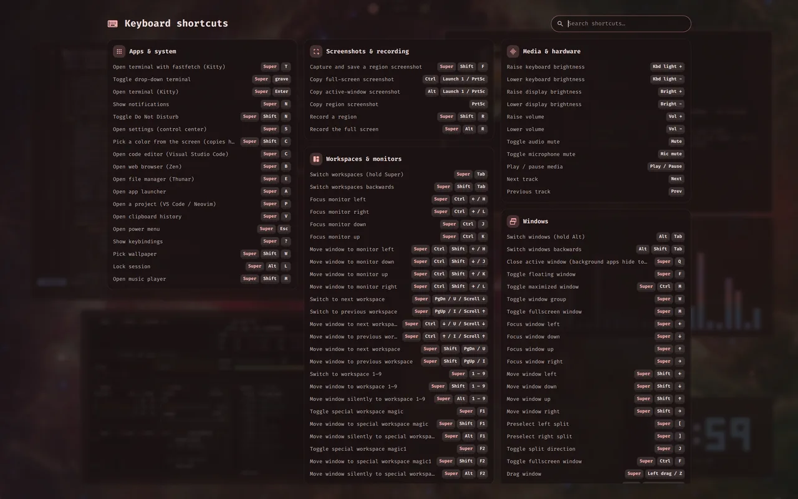
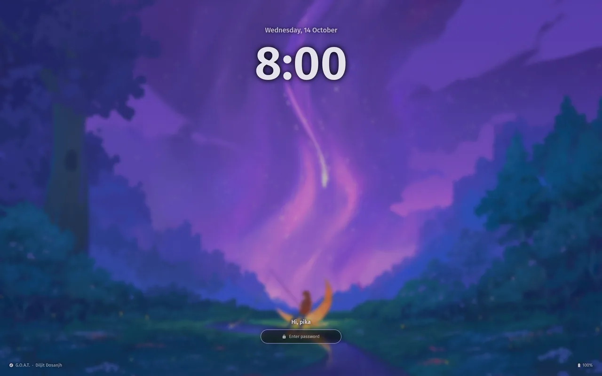

# pikadots

A Hyprland desktop for Arch Linux and CachyOS that takes its colors from the wallpaper, with a
Quickshell bar and a `pikadots` command to install, check, repair and update it.



## One desktop, any wallpaper

| | |
|---|---|
|  |  |
|  |  |

## Screenshots

| | |
|---|---|
|  Control center (Super + S) |  Launcher (Super + A) |
|  Power menu |  Shortcuts (Super + ?) |
|  Lock screen |  Settings (Super + ,) |

## Features

- **Colors from the wallpaper**: the bar, terminal, Neovim, GTK apps, lock screen and keyboard
  lights follow it. Bright wallpapers give a light theme, black and white ones a grey theme.
- **A minimal bar**: workspaces, clock (a live spectrum while music plays), the weather (with a
  forecast panel) and your profile picture, which opens a control center with tabs for your
  account and quick settings, music, notifications, network (with a speed test), Bluetooth, sound,
  displays, battery and more.
- **A Settings app** (Super + ,): wallpaper, light/dark, palette, fonts, bar, gaps, borders,
  blur, animations, input, notifications, lock screen, idle timers, default and startup apps, all
  applied live and searchable.
- **Launcher** with a calculator, commands, emoji, projects and clipboard history.
- **Alt + Tab with live previews**, a workspace overview and a drop-down terminal.
- **Developer setup**: keyring and SSH agent, git with delta, GitHub notifications, per-project
  tool versions, encrypted daily backups.
- **Laptop care**: charge limit, GPU modes and keyboard lighting on ASUS ROG, power profiles,
  idle lock.

## Install

Needs Arch Linux or a derivative, and a login manager with a Hyprland session.

```sh
git clone https://github.com/rameezrajapathan/dotfiles.git ~/dotfiles
~/dotfiles/install.sh
```

Log out, choose **Hyprland**, then:

1. Pick a wallpaper with **Super + Shift + W**. Seven [come with it](wallpapers/CREDITS.md); add
   your own to `~/Pictures/Wallpapers`.
2. Set resolution, refresh rate, scale and layout from the Displays tab of the control center.
3. Optional: `pikadots backup-init` for backups, `gh auth login` for GitHub notifications.
4. Run `pikadots health` to check everything.

Existing configs are backed up first; `pikadots uninstall` restores them. Super + ? shows every
shortcut.

## Docs

- [The desktop](docs/desktop.md): bar, control center, launcher, overlays
- [The Settings app](docs/settings.md)
- [Keybindings](docs/keybindings.md)
- [Colors from the wallpaper](docs/theming.md)
- [The pikadots command and backups](docs/pikadots.md)
- [Developer tools](docs/developer.md)
- [Laptop, power and apps](docs/laptop.md)
- [Troubleshooting](docs/troubleshooting.md)

## Credits

[Hyprland](https://hyprland.org), [Quickshell](https://quickshell.org),
[matugen](https://github.com/InioX/matugen), [Catppuccin](https://catppuccin.com),
[Material Symbols](https://fonts.google.com/icons),
[Papirus](https://github.com/PapirusDevelopmentTeam/papirus-icon-theme). Wallpapers are public domain
or CC0 ([credits](wallpapers/CREDITS.md)). The fastfetch pika is
cropped from ["Royle's Pika in it's home"](https://commons.wikimedia.org/wiki/File:Royle%27s_Pika_in_it%27s_home.jpg)
by Nikeet123, [CC BY-SA 4.0](https://creativecommons.org/licenses/by-sa/4.0/).
