# pikadots

A Hyprland desktop for Arch Linux, CachyOS and Fedora that takes its colors from the wallpaper, with a
Quickshell bar and a `pikadots` command to install, check, repair and update it.

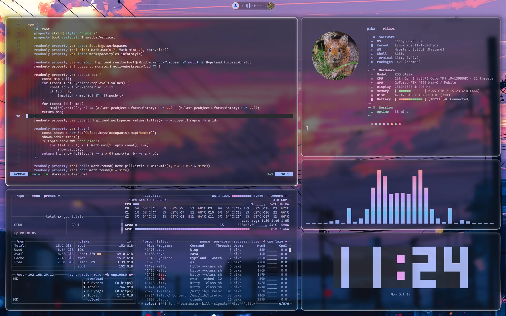

## One desktop, any wallpaper

| | |
|---|---|
|  |  |
|  |  |

Apps follow too: Firefox, Zen and Thunderbird, VS Code (its own Pikadots theme), superfile, lazygit and
mpv, next to kitty, Neovim (a `pikadots` colorscheme), btop, cava and the GTK and Qt apps.


## Screenshots

| | |
|---|---|
| 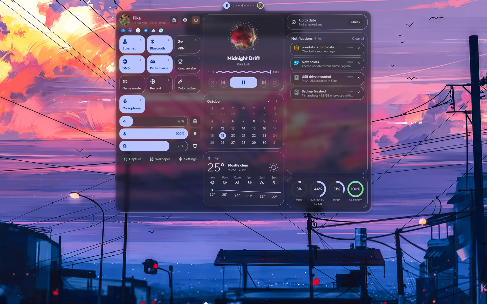 Control center (Super + S) | 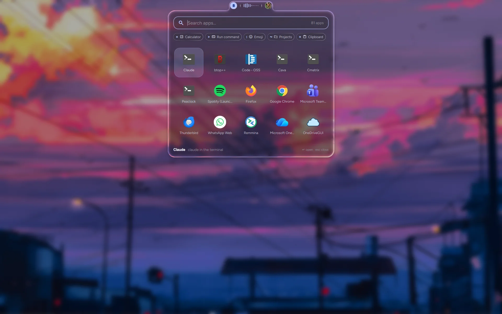 Launcher (Super + A) |
| 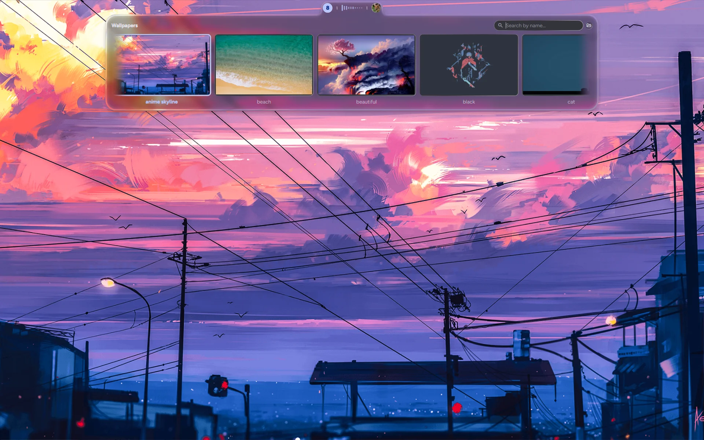 Wallpapers (Super + Shift + W) | 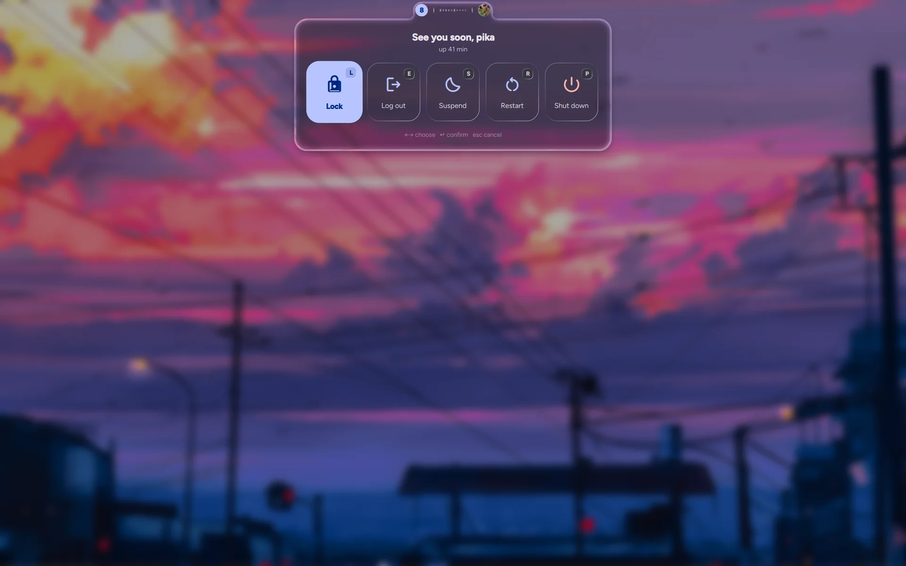 Power menu (Super + Escape) |
| 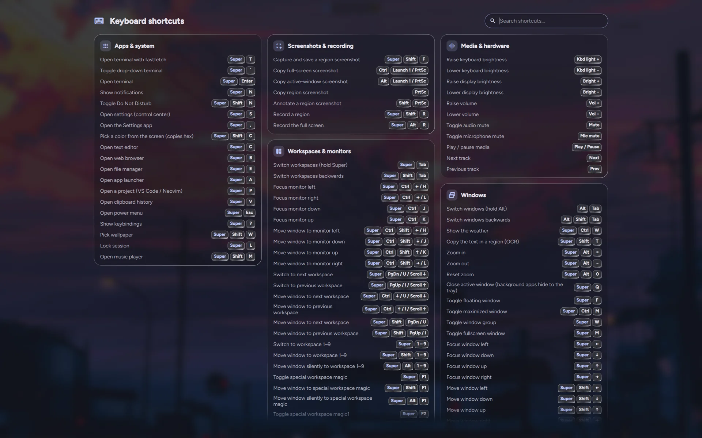 Shortcuts (Super + ?) | 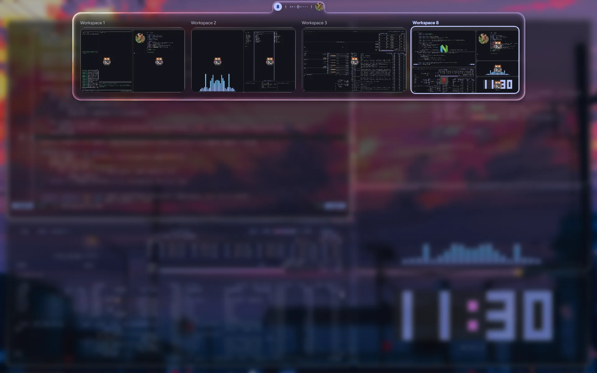 Overview (Super + Tab) |
|  Settings (Super + ,) |  Window rules |

## Bar styles

Ten ready-made styles in Settings > Bar, or your own: one pill, islands or a full-width bar on any
edge of the screen, with the items you pick ([more](docs/desktop.md#the-bar)).

| Style | |
|---|---|
| **Minimalist**<br>one pill | 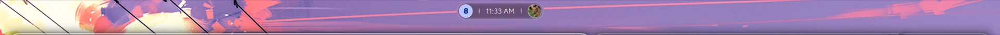 |
| **Focus**<br>one pill | 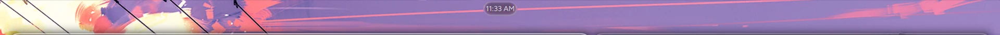 |
| **Everyday**<br>islands | 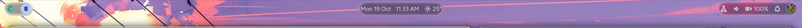 |
| **On the go**<br>one pill | 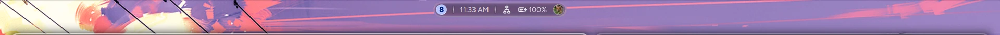 |
| **Music lover**<br>islands | 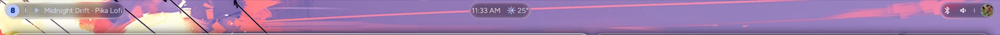 |
| **Developer**<br>full width | 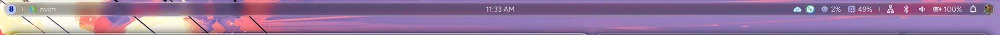 |
| **Islands**<br>islands | 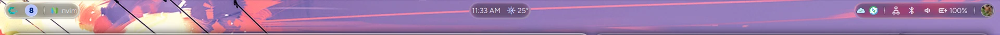 |
| **Floating**<br>full width | 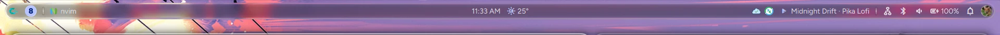 |
| **Classic**<br>full width | 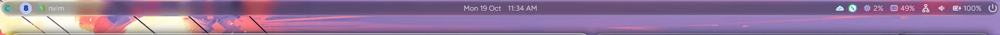 |
| **Maximalist**<br>full width | 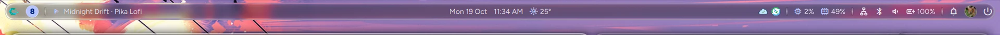 |

## Features

- **Colors from the wallpaper**: the bar, terminal, Neovim, btop, cava, VS Code, Firefox, GTK and
  Qt/KDE apps, lock screen and keyboard lights follow it (the login screen and boot splash on request). Bright wallpapers give a light theme, black and white ones a grey theme.
- **Liquid glass**: the bar, panels, windows and terminal turn translucent together, with a rim of
  light and a slight refraction at the edges. Frosted by default, or Clear, Off or your own mix in
  Settings > Appearance > Glass ([more](docs/theming.md#liquid-glass)).
- **A bar your way**: by default one minimal pill with workspaces, the clock (a live spectrum while
  music plays) and your profile picture, which opens a control center: quick tiles,
  sliders, music, notifications and more at a glance, in one column, a three-column Bento or
  your own layout, with details for network (with a speed test), Bluetooth, sound, displays,
  battery and more a click away. Ten ready-made styles (Minimalist, Focus, Everyday, Developer,
  Islands, Floating, Classic, Maximalist…) or your own: one pill, islands or a full-width bar on
  any screen edge, floating or attached to it, with 20 items (weather, window title, tray, status
  icons, CPU, now playing…) placed where you want and eight workspace styles.
- **A Settings app** (Super + ,): wallpaper, light/dark, palette, font themes, icon themes, bar
  styles, accessibility (zoom, text size, reduce motion), gaps, borders, blur, animations, window
  rules, input, notifications, lock screen, idle timers, night light schedule, drives, date & time
  and world clocks, default and startup apps, and updates for pikadots and the system, all applied
  live and searchable.
- **Window rules** per app: floating, a corner, edge or exact spot, size, workspace and opacity.
  Terminal apps such as cava, peaclock or btop get a launcher entry of their own, so they can open
  floating exactly where you want them.
- **Launcher** with a calculator, commands, emoji, projects and clipboard history with pins.
- **Screenshots** to draw on (satty) or read text from (OCR), USB drives that mount with a
  notification, a privacy pill while the mic, camera or screen is in use, password prompts and game
  mode in the shell's own style.
- **Alt + Tab with live previews**, a workspace overview and a drop-down terminal.
- **Developer setup**: keyring and SSH agent, git with delta, GitHub notifications, per-project
  tool versions, encrypted daily backups.
- **Laptop care**: charge limit, GPU modes and keyboard lighting on ASUS ROG, power profiles,
  idle lock.

## Install

Needs Arch Linux or a derivative, or Fedora 43 or newer, and a login manager with a Hyprland session.
On Fedora, Hyprland, Quickshell and a few tools come from COPR repositories ([`copr.txt`](copr.txt)).

```sh
git clone https://github.com/rameezrajapathan/dotfiles.git ~/dotfiles
~/dotfiles/install.sh
```

Log out, choose **Hyprland**, then:

1. Pick a wallpaper with **Super + Shift + W**. Seven [come with it](wallpapers/CREDITS.md); add
   your own to `~/Pictures/Wallpapers`.
2. Set resolution, refresh rate, scale and layout from the control center (the monitor button next to brightness).
3. Optional: `pikadots backup-init` for backups, `gh auth login` for GitHub notifications, or
   `pikadots import <file>` to bring your settings from another machine (`pikadots export` there).
4. Run `pikadots health` to check everything.

Existing configs are backed up first; `pikadots uninstall` restores them. Super + ? shows every
shortcut.

## Docs

- [The desktop](docs/desktop.md): bar, control center, launcher, overlays, lock screen
- [The Settings app](docs/settings.md)
- [Keybindings](docs/keybindings.md)
- [Colors from the wallpaper](docs/theming.md)
- [The pikadots command and backups](docs/pikadots.md)
- [Developer tools](docs/developer.md)
- [Laptop, power and apps](docs/laptop.md)
- [Troubleshooting](docs/troubleshooting.md)

## Credits

[Hyprland](https://hyprland.org), [Quickshell](https://quickshell.org),
[matugen](https://github.com/InioX/matugen), [Catppuccin](https://catppuccin.com),
[Material Symbols](https://fonts.google.com/icons),
[Papirus](https://github.com/PapirusDevelopmentTeam/papirus-icon-theme). Wallpapers are public domain
or CC0 ([credits](wallpapers/CREDITS.md)). The fastfetch pika is
cropped from ["Royle's Pika in it's home"](https://commons.wikimedia.org/wiki/File:Royle%27s_Pika_in_it%27s_home.jpg)
by Nikeet123, [CC BY-SA 4.0](https://creativecommons.org/licenses/by-sa/4.0/).
