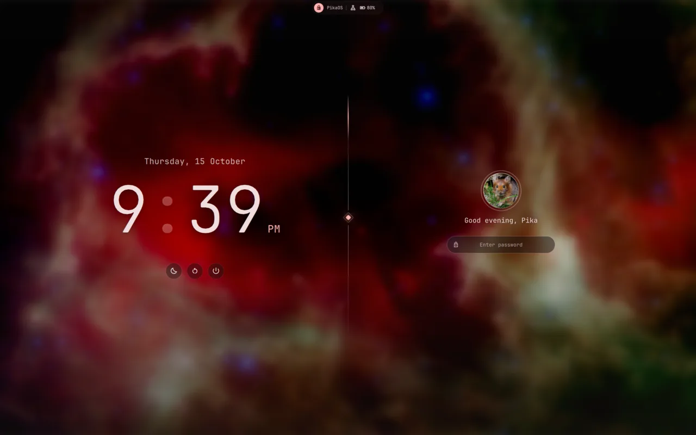

# The desktop

[← README](../README.md)

## The bar

By default (the **Minimalist** style) one pill in the middle: the current workspace number in a
circle (click for the overview, scroll to go through workspaces; a red ring means another workspace
wants attention), the clock (click for the calendar; `qs ipc call calendar toggle` opens it too) and
your profile picture, which opens the control center. A dot on the picture means there are
notifications; upload a picture from the Account tab. While music plays, a small spectrum takes the
clock's place; clicking it opens the Music tab. The recording timer shows while recording (click to
stop), and the [next meeting](developer.md#next-meeting) shows once a calendar is set.

Settings > Bar has nine more styles and a custom setup: one pill, a pill per section (islands) or
one bar across the screen; height, spacing, roundness and an outline; and which items go left, in
the middle and right. Besides the ones above there are the weather (click for the forecast), the
date, the apps button (distro logo, opens the launcher), the focused window's title, now playing
(right click plays or pauses, scroll skips), the tray, CPU and memory, network, Bluetooth (right
click turns it on or off), sound (scroll for volume, right click mutes), battery, notifications
(right click for Do Not Disturb), a capture button, power and dividers. Status icons open their
control center tab. See [settings.md](settings.md#bar).

## Calendar

Click the clock (or the date). The time, the month (arrows or scroll change it, the month name
returns to today) and, if you add them in Settings > Date & time, week numbers and world clocks
with the time difference from yours. The week starts on Monday, Sunday or Saturday as you choose.

## Weather (Super + Ctrl + W)

Comes out of the bar from the weather item (add it in Settings > Bar or Settings > Weather; Super +
Ctrl + W opens it either way), in the same plain style as the other panels: the temperature, conditions, feels like and today's high and low; the next 24 hours as a
thin line (scroll sideways) with the chance of rain; 7 days with each day's range against the
week's; and humidity, wind, UV, air quality, the next sunrise or sunset, and pressure.

Data comes from [Open-Meteo](https://open-meteo.com) (no account or key) and refreshes every 15
minutes. The place is found from your connection (ipinfo.io); click it to search for a city, or
pick "Use my location" to go back. °C / °F switches the units (wind follows: km/h or mph). Both
are saved in `~/.local/state/quickshell/weather.json`. `qs ipc call weather toggle` opens it,
`qs ipc call weather refresh` reloads it.

## Control center

The profile picture drops down one window, attached to the bar, with a tab for everything else.
Super + S opens it too, and it works from the keyboard alone: Esc or a click outside closes it,
Up/Down, Tab, Ctrl + Tab or J/K switch tabs, and 1–9 and 0 jump to a tab in sidebar order. `qs ipc
call controlcenter toggle <tab>` opens a tab from a keybind; the tabs are `account`, `music`,
`notifications`, `network`, `bluetooth`, `audio`, `display`, `battery`, `system`, `capture` and
`github`.

| Tab | What's in it | Right click on the tab |
|---|---|---|
| Account | Profile picture (click it to upload one; saved square-cropped as `~/.face` and sent to AccountsService for the login screen), name, quick settings (Do Not Disturb, keep awake, night light, color picker), lock, log out, power menu | |
| Music | Album art in a slowly turning scalloped frame with the live spectrum around it, title, artist and album, a wavy seek bar, round controls around a wide play button, the players (when there are several), open the app, volume | Play/pause |
| Notifications | Notifications not yet dismissed | Do Not Disturb |
| Network | Live download/upload speed with a one-minute graph, speed test (ping, download and upload against Cloudflare with curl; the gauge button next to settings), wired, Wi-Fi (asks for passwords), VPN switches, import or add a VPN | |
| Bluetooth | Paired devices (connect, battery, forget), nearby devices to pair | Power on/off |
| Sound | Output and input devices, per-app volume | Mute |
| Displays | [Displays](#displays) | |
| Battery | Time left, charge limit, power mode, GPU mode on ROG laptops | |
| System | CPU, memory, GPU and disk with temperatures, busiest processes, last backup | |
| Capture | Screenshot or record a region, window or screen | |
| GitHub | Notifications; only after `gh auth login` | |

The bottom of the sidebar has the tray and hidden background apps (click opens the app, right
click shows its menu), the wallpaper picker (Super + Shift + W), a coffee cup while keep awake is
on, and the power menu. The launcher is Super + A.

## Motion

Panels slide or fade both ways, and selection highlights (control center tabs, launcher, Alt + Tab,
workspace pill) glide instead of jumping. The control center, calendar, weather, launcher, wallpaper picker,
power menu, overview (one row of workspaces) and Alt + Tab switcher come out of the bar: from the
pill that holds the item they belong to (its bottom squares off and the panel slides out from under
it), or from under that item on a full-width bar. Only one is open at a time: opening
another (or the cheatsheet) closes it. When the keyboard moves focus to another window (arrows, Alt
+ Tab), the mouse pointer glides there instead of jumping (Hyprland's own warps are off:
`cursor.no_warps` in `settings.lua`, done by `CursorGlide.qml`); it stays put when the mouse did the
focusing (the pointer is in or right next to the window, or still moving), for new windows and on
workspace switches.

## Displays

The Displays tab has a card per screen: on/off, resolution, refresh rate and scale, and with two
screens, which side of the other it sits on, or mirroring. Changes apply at once and are remembered
per monitor, so it comes back the same when plugged in again. The **reset** button (circular arrow) returns it to the defaults.

The tab saves to `~/.local/state/pikadots/monitors.lua`, which `hypr/.config/hypr/monitors.lua`
loads after its own rules. Edit `monitors.lua` only to change those defaults.

## Launcher (Super + A)

Apps, most used first. A first character switches mode:

| Prefix | Mode | Enter | Shift + Enter |
|---|---|---|---|
| `=` | Calculator (`=5 GiB to MB`) | Copy result | |
| `>` | Command | Run | Run in a terminal |
| `:` | Emoji | Copy | |
| `~` | Projects (git repos you visit) | Default editor | Terminal there |
| `+` | Clipboard history | Copy | |

## Overlays

- **Power menu** (Super + Escape): lock, log out, suspend, restart, shut down (L / E / S / R / P).
- **Alt + Tab**: live window previews; release Alt to switch.
- **Overview** (Super + Tab): every workspace in a row with live previews. Like Alt + Tab: hold
  Super, Tab or Shift + Tab moves, releasing Super switches, Esc cancels.
- **Drop-down terminal** (Super + \`): stays running while hidden.
- **Cheatsheet** (Super + ?): every shortcut, read live from Hyprland.
- **Volume and brightness indicator** when those keys are used.

## Notifications

Popups at the top right by default (Settings > Notifications sets the corner, size and timeout);
hovering pauses the timeout. Critical ones stay until dismissed and get
through Do Not Disturb (Super + Shift + N).

## Lock screen

Part of the shell (`quickshell/Lock.qml`), split in two over the blurred wallpaper. The left half
has the date and a big clock, now playing (controls and a live spectrum) and suspend, restart and
power off (restart and power off ask for a second click). The right half has your profile picture
and the password pill: dots pop in, it shakes on a wrong password, and Caps Lock warns. Between them
runs a fading line with a glowing accent diamond and a light travelling down it. After 15 seconds
without input it rests: the blur softens and the right half dims to "Press any key". Any key or
mouse movement wakes it; Esc clears the pill.

Locks after 10 minutes idle (Settings > Power), before suspend, or with Super + Alt + L. Settings >
Lock screen sets the blur, rest delay and what it shows. `hypr/scripts/lock.sh` falls
back to hyprlock if the shell isn't running, and a restarted shell locks again if it crashed while
locked.

## Default apps

The easiest way to change these is the Settings app's Default apps page
([settings.md](settings.md)); the commands below do the same.

Keybinds, the bar and the launcher never name an app: they open the system's default terminal,
browser, file manager and editor through `hypr/scripts/app.sh`. Change them with:

| App | Change with | pikadots sets (if unset) |
|---|---|---|
| Terminal (Super + Return, Super + T, Super + \`) | first line of `~/.config/xdg-terminals.list`, e.g. `foot.desktop` | kitty |
| Browser (Super + B) | `xdg-settings set default-web-browser firefox.desktop` | — (your choice) |
| File manager (Super + E) | `xdg-mime default thunar.desktop inode/directory` | Thunar |
| Editor (Super + C, launcher projects) | `xdg-mime default code-oss.desktop text/plain` | Neovim |

Terminal editors open in the default terminal. The terminal list is read by
[xdg-terminal-exec](https://gitlab.freedesktop.org/terminal-wg/specifications), which apps that
open a terminal also use; `pikadots install` writes it with kitty if it's missing.

## Terminal

kitty with starship, eza and zoxide. Super + T opens it with fastfetch. Its font is set in
Settings > Fonts & icons (a font theme or the terminal font). The cursor glides to
where it jumps, with a short trail (`cursor_trail` in `kitty/.config/kitty/kitty.conf`), and its
blink fades.
