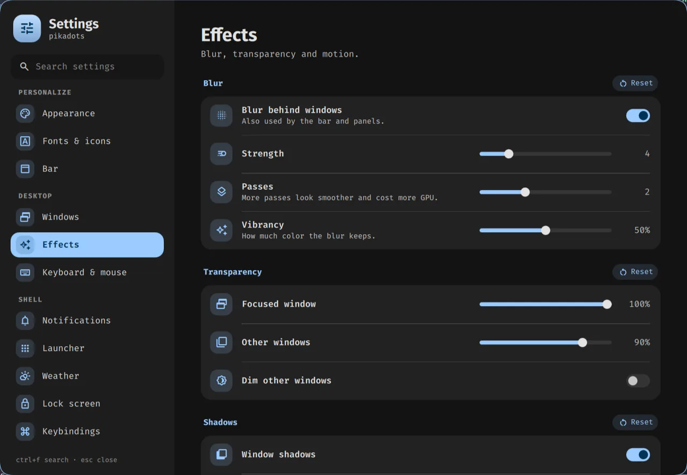
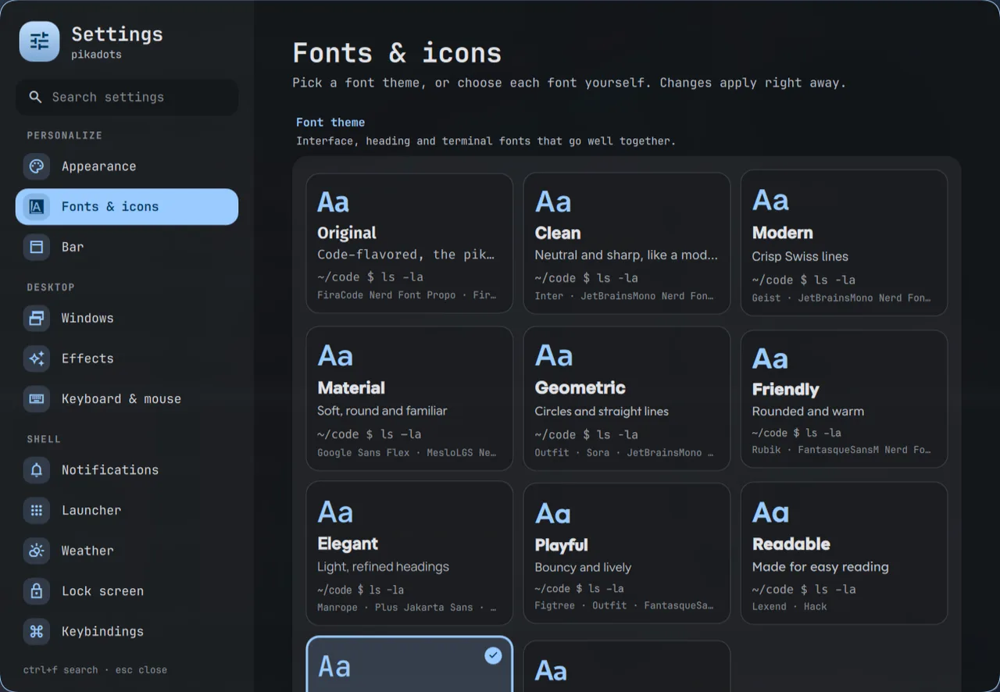
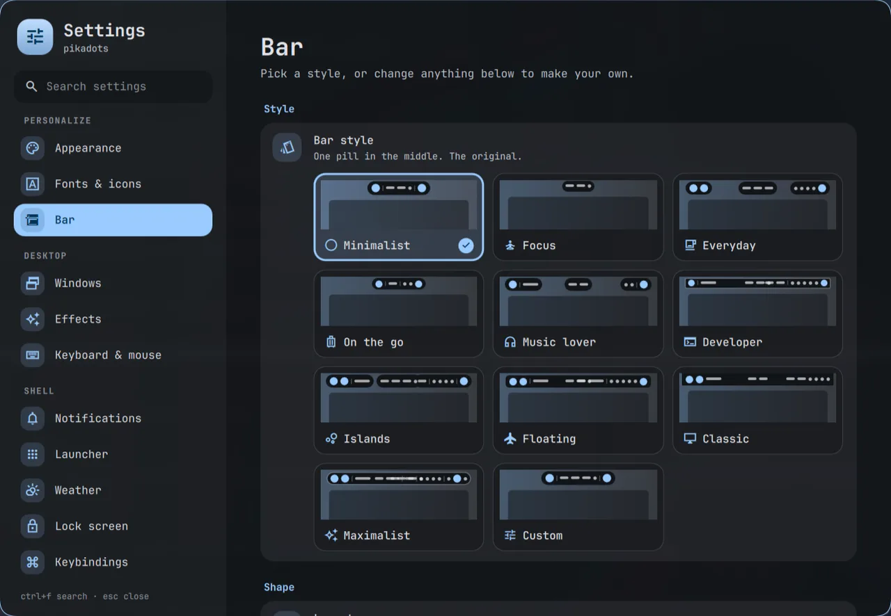

# The Settings app

**Super + ,** (comma) opens it; so do the gear at the bottom of the control center, "Settings" in
the launcher, and `qs ipc call settings open <page>` (page names below). It's a normal floating
window: categories on the left, one page at a time on the right. Everything applies at once.

**Search** (Ctrl + F) finds pages and individual settings: matching settings are listed first, and
Enter or a click opens the page, scrolls to the setting and highlights it. Esc clears the search,
then closes the window.

## Pages

| Page | `open` name | What's in it |
|---|---|---|
| Appearance | `appearance` | Wallpaper strip (click to apply and recolor), light/dark/auto mode, palette style (tonal, vivid, expressive, neutral, monochrome, …), current palette, Qt and KDE apps on/off, bar and panel opacity |
| Fonts & icons | `fonts` | Font themes (interface + heading + terminal font pairings), or each font on its own: interface, display (headings, lock clock), terminal (kitty); optionally used by GTK apps too; text size; shell symbol style (Rounded, Outlined, Sharp) and weight; app icon theme |
| Bar | `bar` | Styles (Minimalist, Focus, Everyday, On the go, Music lover, Developer, Islands, Floating, Classic, Maximalist, Custom); layout (one pill, islands, full width), height, space above and at the sides, roundness, outline; the items in each section; 24-hour clock, seconds, music spectrum |
| Accessibility | `accessibility` | Screen zoom around the pointer (Hyprland `cursor:zoom_factor`, not saved; Super + Alt + = / − / 0), text size for the shell, GTK and Qt apps (`hypr/scripts/accessibility.sh`), reduce motion (the shell's transitions become instant through `Theme.ms()`, Hyprland, GTK and KDE animations off; spinners keep turning) |
| Windows | `windows` | Tiling layout (dwindle, master, scrolling), gaps, border width, resize on borders, corner roundness and shape |
| Effects | `effects` | Blur (strength, passes, vibrancy), window opacity, dimming, shadows, animation speed and workspace switch style (the bar's workspace number animates the same way) |
| Window rules | `rules` | Per app (window class; open windows listed first): floating, centered, size, on every workspace, fullscreen, no blur, workspace (and whether to switch to it), opacity. Written to `~/.local/state/pikadots/window-rules.lua`, loaded at the end of `hypr/rules.lua`; Hyprland reloads after a change |
| Keyboard & mouse | `input` | Keyboard layouts and options, key repeat, pointer speed and acceleration, focus follows mouse, touchpad, cursor theme and size |
| Notifications | `notifications` | Do Not Disturb, daily quiet hours, popup position, duration, count and width, test notification |
| Launcher | `launcher` | Columns, icon size, most used first, forget usage, each typed mode on or off; clipboard history size, keep copied text when the app closes (wl-clip-persist), clear history |
| Weather | `weather` | °C/°F, show in the bar (adds or removes the bar's Weather item), automatic location or city search |
| Lock screen | `lock` | Wallpaper blur, now playing, power buttons, rest delay |
| Keybindings | `keybinds` | Every shortcut, searchable; opens `keybinds.lua` |
| Network, Bluetooth, Sound, Displays | `network`, `bluetooth`, `sound`, `displays` | The control center's panels; Displays adds night light warmth and schedule (sunset to sunrise at Weather's place, or custom times; switching it by hand holds until the next change) |
| Drives | `drives` | The Drives panel; open a drive as soon as it's plugged in (a notification offers Open and Eject) or only offer to, show it in the file manager |
| Date & time | `datetime` | Time zone (search or detect from the network), network time or setting the clock by hand (timedatectl; asks for the admin password), 24-hour time, seconds, the bar's date format, first day of the week, week numbers, world clocks in the calendar |
| Power | `power` | Battery panel, idle timers (dim, lock, screen off, sleep), lock before sleep, keep awake |
| Default apps | `apps` | Browser, terminal, files, editor, email, pictures, videos, music, PDFs |
| Startup apps | `startup` | Apps and commands started at login |
| Updates | `updates` | pikadots (what's new on the remote, local changes and unpushed commits; Update runs `pikadots update` in a terminal) and system packages (pacman via checkupdates, AUR via yay/paru, Flatpak; Update system runs in a terminal), check interval and notifications |
| About | `about` | This machine and versions |

## Where choices are kept

Nothing in the repo changes; your choices stay on this machine:

| File | Written by | Read by |
|---|---|---|
| `~/.config/pikadots/settings.json` | the app (`quickshell/Settings.qml`) | the shell, and these scripts in `hypr/scripts`: `theme.sh` (mode, palette style), `idle.sh` (timers), `fonts.sh`, `icons.sh`, `kde-theme.py`, `accessibility.sh`, `clipboard.sh` |
| `~/.local/state/pikadots/hypr-settings.lua` | Windows, Effects, Keyboard & mouse (`quickshell/Hypr.qml`) | end of `hypr/settings.lua` |
| `~/.local/state/pikadots/window-rules.lua` | Window rules | end of `hypr/rules.lua` |
| `~/.local/state/pikadots/autostart.lua` | Startup apps | end of the start handler in `hypr/autostart.lua` |
| `$XDG_RUNTIME_DIR/hypridle.conf` | `hypr/scripts/idle.sh` at login and after a change | hypridle (`hypridle.conf` in the repo shows the defaults) |
| `~/.config/xdg-terminals.list`, xdg-mime defaults | Default apps (`hypr/scripts/default-apps.py`) | `hypr/scripts/app.sh` |
| `~/.local/state/pikadots/kitty-font.conf` | Fonts & icons (`hypr/scripts/fonts.sh`) | kitty (`include` in `kitty.conf`) |
| `~/.local/state/pikadots/icon-theme`, GTK `icon-theme` | Fonts & icons (`hypr/scripts/icons.sh`) | `hypr/scripts/shell.sh` (the shell's icons), GTK apps |
| GTK `font-name`, `monospace-font-name` | Fonts & icons with "Use in apps" (`fonts.sh`) | GTK apps |
| GTK `text-scaling-factor`, `enable-animations` | Accessibility (`hypr/scripts/accessibility.sh`) | GTK apps |
| `~/.config/kdeglobals` (colors, icons, fonts, animation speed) | Appearance, Fonts & icons, Accessibility (`hypr/scripts/kde-theme.py`; Plasma's values saved in `~/.local/state/pikadots/kdeglobals-plasma.json`) | Qt and KDE apps |
| `~/.local/share/pikadots/clipboard-pins/` | Ctrl + P in the launcher's clipboard mode (`hypr/scripts/clipboard.sh`) | the launcher |
| System time zone and clock | Date & time (`timedatectl`, through `quickshell/TimeDate.qml`) | the whole system |
| `~/.cache/pikadots/icon-themes.json` | `hypr/scripts/icon-themes.py` (a cache) | Fonts & icons |

Hyprland options only store what you changed: sections with changes show a **Reset** button, which
removes them and reloads Hyprland so `settings.lua`'s values come back. Deleting `settings.json`
(and the three `.lua` files) returns everything to the defaults. `pikadots export` saves all four
to one file for another machine ([pikadots.md](pikadots.md#export-and-import)).

## Fonts

The font lists show every font installed on the system. Nice UI fonts to try (not installed by
pikadots): Inter, Google Sans Flex, Rubik, Outfit, Manrope, Plus Jakarta Sans, Figtree, Geist. Put
`.ttf` files in `~/.local/share/fonts`, run `fc-cache -f`, then restart the shell
(`qs kill; setsid -f ~/.config/hypr/scripts/shell.sh`) so it sees them.

Font themes are listed in `quickshell/FontThemes.qml`; a theme only shows when all three of its
fonts are installed. The terminal font goes to kitty through
`~/.local/state/pikadots/kitty-font.conf` (included by `kitty.conf`, written by
`hypr/scripts/fonts.sh`). "Use in apps" sets the interface and monospace fonts for GTK, Qt and KDE apps, and
turning it off resets them.

## Icons

Shell icons are Material Symbols; their style and weight change live. The app icon theme is a
family (Papirus, breeze, …) picked from every theme in `~/.local/share/icons`, `~/.icons` and
`/usr/share/icons` (`hypr/scripts/icon-themes.py`, cached in `~/.cache/pikadots`).
`hypr/scripts/icons.sh` uses its dark variant (`-Dark`/`-dark`) in dark mode, and theme.sh does
the same on every wallpaper change. Applying a theme restarts the shell, which reads its icon
theme only at start (`hypr/scripts/shell.sh` starts it with the saved one). To add themes, install
them for your user, for example
`git clone --depth 1 https://github.com/vinceliuice/Tela-circle-icon-theme && Tela-circle-icon-theme/install.sh`
(Colloid, Fluent, WhiteSur and Qogir install the same way).

## Bar

A style sets the layout, size, spacing, roundness, outline and items all at once
(`quickshell/BarStyles.qml`); changing any of them makes it "Custom", and the last custom setup
comes back when you click the Custom card. Items (`BarModule.qml`): workspaces, apps (distro
logo), window title, clock, date, weather, next meeting, now playing, recording & privacy (only while
recording, or while the mic, camera or screen is in use), capture, tray, CPU & memory, network, Bluetooth, sound, battery, notifications,
profile (control center), power and dividers. Dividers hide themselves when there's nothing on
one side. Panels drop out of the pill that holds their item (the clock's calendar, the sound
icon's Sound tab...), or hang from a full-width bar under it.

## Date & time

The time zone and clock are the system's (`timedatectl`), so changing them asks for the admin
password (the shell's polkit prompt). "Detect" looks the zone up from your network location
(ipinfo.io, as the weather does). The bar keeps the old zone until the shell restarts; the page
offers a button for that. World clocks, the week start and week numbers show in the calendar.

## Updates

The page checks when it opens and in the background (every 6 hours by default, the first check a
minute after login), with a notification when something new turns up
(`hypr/scripts/updates.sh`, `quickshell/Updates.qml`; `qs ipc call updates check`). pikadots: it
fetches the repo and lists the new commits, local changes and unpushed commits; **Update** runs
`pikadots update` in a terminal (**Repair**, when there's nothing new, runs `pikadots repair`). System: pacman (`checkupdates`, no root needed), AUR (yay or paru)
and Flatpak; **Update system** runs the upgrade in a terminal, since it asks for your password.
