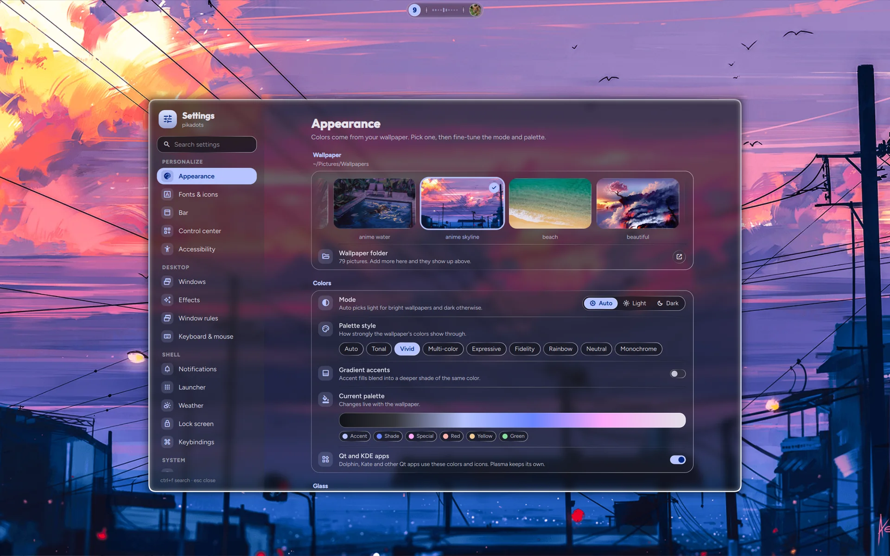
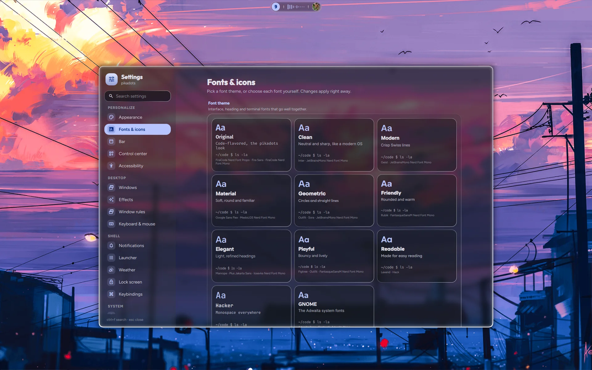
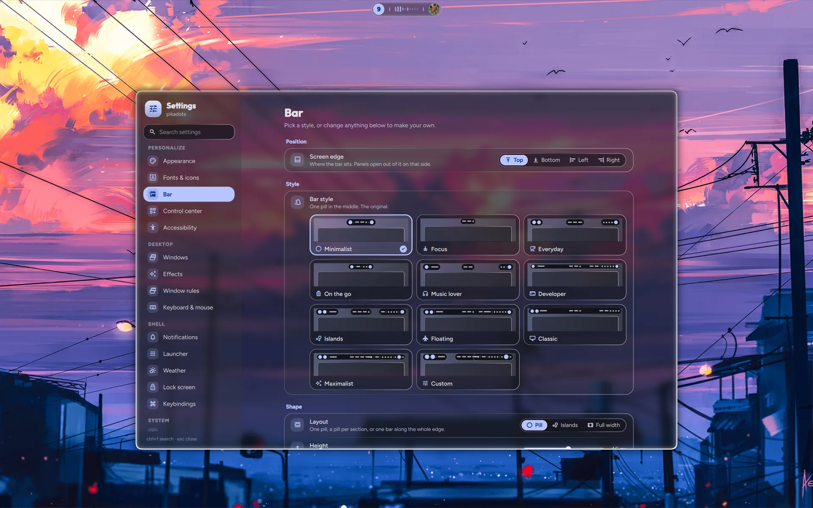
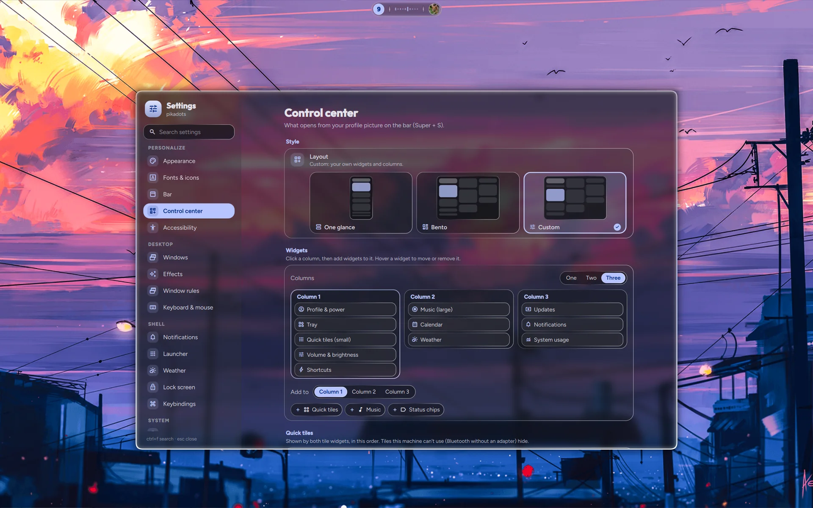
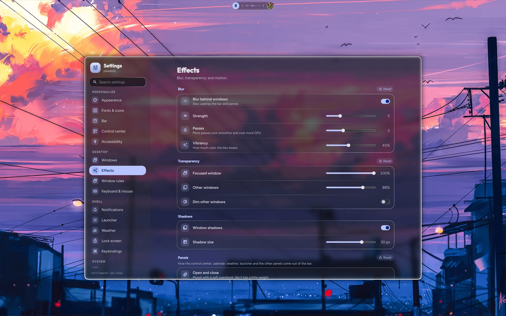
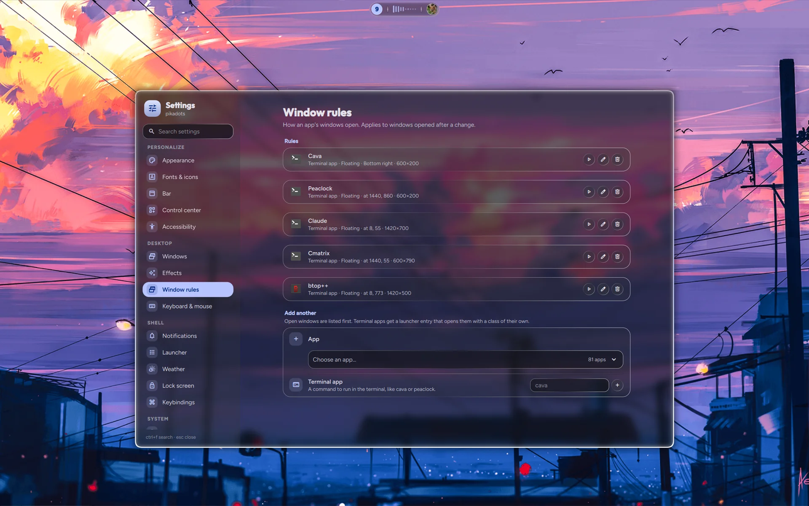

# The Settings app

**Super + ,** (comma) opens it; so do the gear in the Profile & power row at the top of the
control center (right click opens the Control center page), "Settings" in the launcher, and
`qs ipc call settings open <page>` (page names below). It's a normal floating
window: pages on the left in four groups (Personalize, Desktop, Shell, System), one page at a time
on the right. Everything applies at once. Ctrl + Tab and Ctrl + Shift + Tab go to the next and
previous page. In a narrow window the page list becomes a drawer.

**Search** (Ctrl + F) finds pages and individual settings: matching settings are listed first, and
Enter or a click opens the page, scrolls to the setting and highlights it. Esc closes the drawer,
then clears the search, then closes the window.

## Pages

| Page | `open` name | What's in it |
|---|---|---|
| Appearance | `appearance` | Wallpaper strip (click to apply and recolor), wallpaper folder (opens `~/Pictures/Wallpapers`), light/dark/auto mode, palette style (auto, tonal, vivid, multi-color, expressive, fidelity, rainbow, neutral, monochrome), gradient accents, current palette, Qt and KDE apps on/off, **Glass** (Off, Frosted, Clear or Custom with a live preview; wallpaper color (off = colorless glass); light direction; in Custom: shell tint, cards, app windows, terminal, rim light, refraction, color fringe, blur radius and passes, vibrancy, inactive windows, shadows — see [theming.md](theming.md#liquid-glass)), **Cursor** (theme and size 24, 28, 32, 40 or 48, with Reset; for Hyprland, GTK and Qt/KDE apps), corner roundness for the whole shell and Hyprland windows (0% square, 100% default, 200% circles and pills) |
| Fonts & icons | `fonts` | Font themes (interface + heading + terminal font pairings), or each font on its own: interface, display (headings, lock clock), terminal (kitty); optionally used by GTK apps too; text size; shell symbol style (Rounded, Outlined, Sharp), and weight; app icon theme; *Folder color follows accent* (Papirus only, see [Icons](#icons)) |
| Bar | `bar` | Screen edge (top, bottom, left, right); styles (Minimalist, Focus, Everyday, On the go, Music lover, Developer, Islands, Floating, Classic, Maximalist, Custom); layout (one pill, islands, full width), height, space at the edge (*space before windows* when attached), attached to the edge, space at the sides, outline; the items in each section; the [workspaces indicator](#workspaces); 24-hour clock, seconds, music spectrum |
| Dock | `dock` | Show the dock, hiding (always, auto-hide, intellihide), all screens or the main one, screen edge (bottom, left, right; never the bar's), glass (System, Frosted, Clear, Solid), icon size, magnify on hover and how much, running indicator (dot, line, ring, pill, none; one mark per window; color), open apps that aren't pinned, apps on special workspaces, preview delay, pulse while opening, launcher button, pinned apps (reorder, remove, add). Saved as `dock` in `settings.json` |
| Control center | `controlcenter` | Layout (One glance, Bento or Custom, with a drawing of each), the widgets in each of one to three columns, and the quick tiles in order (Wi-Fi, Bluetooth, VPN, Do Not Disturb, night light, power profile, keep awake, game mode, microphone, record, color picker). Saved as `controlCenter` in `settings.json` |
| Accessibility | `accessibility` | Screen zoom around the pointer (Hyprland `cursor:zoom_factor`, not saved; Super + Alt + = / − / 0), text size for the shell, GTK and Qt apps (`hypr/scripts/accessibility.sh`), reduce motion (the shell's transitions become instant through `Theme.ms()`, Hyprland, GTK and KDE animations off; spinners keep turning), tooltips on or off and how soon they show |
| Windows | `windows` | Tiling layout (dwindle, master, scrolling), gaps, border width, resize on borders, corner shape (roundness follows Appearance) |
| Effects | `effects` | Blur (strength, passes, vibrancy), window opacity, dimming, shadows, how panels open and close (Slide, Morph, Spring, Liquid, Reveal or Fade, each with a live preview, and their speed; *Try it* opens the control center with it), animation speed and workspace switch style (the bar's workspace number animates the same way) |
| Window rules | `rules` | Per app (window class; searchable picker, open windows listed first): floating, position (auto, one of nine spots on a 3×3 grid kept clear of the bar and screen edges, or exact x/y; *Use the open window* copies an open window's place and size), size, on every workspace, fullscreen, no blur, workspace (and whether to switch to it), opacity; ▶ opens the app. **Terminal apps** (a command such as `cava` or `peaclock`, or an installed terminal entry such as btop) get a launcher entry from `hypr/scripts/terminal-app.sh` in `~/.local/share/applications` that opens them in the default terminal with their own class (`pikadots-<name>`), so the rule matches them and not every terminal; deleting the rule removes the entry. Written to `~/.local/state/pikadots/window-rules.lua`, loaded at the end of `hypr/rules.lua`; Hyprland reloads after a change |
| Keyboard & mouse | `input` | "Typing and pointing": keyboard layouts and options, key repeat, pointer speed and acceleration, focus follows mouse, touchpad (the cursor's look is on Appearance) |
| Notifications | `notifications` | Do Not Disturb, daily quiet hours, popup position (top left, top, top right, bottom left, bottom right), how long they show, *Let apps choose how long* (use an app's own timeout), how many at once, width, *Try it* (a test notification) |
| Launcher | `launcher` | Style (attached to bar, attached to dock, centered, fullscreen, Spotlight; with a drawing of each and *Try it*), columns, icon size, most used first, forget usage, each typed mode on or off; clipboard history size, keep copied text when the app closes (wl-clip-persist), clear history |
| Weather | `weather` | °C/°F, show in the bar (adds or removes the bar's Weather item), automatic location or city search |
| Lock screen | `lock` | Wallpaper blur, now playing, power buttons, rest delay; *Lock when idle* (shows the timer, *Change* opens Power) and *Lock now* |
| Keybindings | `keybinds` | Every shortcut, read live from Hyprland, with a filter (an action or a key, such as `Shift`). Click a shortcut's keys and press new ones to change it (Esc cancels; a combo another shortcut uses is refused); the undo button restores one. Changes go to `~/.local/state/pikadots/keybinds.lua`, apply at once and show in Super + ?. The edit button warns first, then opens `keybinds.lua`. *Reset all* (or `pikadots keybinds reset`) clears every change and restores the default `keybinds.lua` if it was edited; the edited copy is saved in `~/.local/state/pikadots/backups` |
| Network, Bluetooth, Sound, Displays | `network`, `bluetooth`, `sound`, `displays` | The control center's panels; Displays adds night light warmth and schedule (sunset to sunrise at Weather's place, or custom times; switching it by hand holds until the next change) |
| Drives | `drives` | The Drives panel; open a drive as soon as it's plugged in (a notification offers Open and Eject) or only offer to, show it in the file manager |
| Date & time | `datetime` | Time zone (search or detect from the network), network time or setting the clock by hand (timedatectl; asks for the admin password), 24-hour time, seconds, the bar's date format, first day of the week, week numbers, world clocks in the calendar |
| Power | `power` | Battery panel, idle timers (dim, lock, screen off, sleep), lock before sleep, keep awake |
| Default apps | `apps` | Browser, terminal, files, editor, email, pictures, videos, music, PDFs |
| Startup apps | `startup` | Apps and commands started at login |
| Updates | `updates` | pikadots (what's new on the remote, local changes and unpushed commits; Update runs `pikadots update` in a terminal) and system packages (pacman via checkupdates, AUR via yay/paru, Flatpak; Update system runs in a terminal), how often to check (manually, hourly, every 6 hours, daily), notifications, *Include system packages* (off: only pikadots) |
| About | `about` | This machine and versions |

## Where choices are kept

Nothing in the repo changes; your choices stay on this machine:

| File | Written by | Read by |
|---|---|---|
| `~/.config/pikadots/settings.json` | the app (`quickshell/services/Settings.qml`) | the shell, and these scripts in `hypr/scripts`: `theme.sh` (mode, palette style), `idle.sh` (timers), `fonts.sh`, `icons.sh`, `kde-theme.py`, `accessibility.sh`, `clipboard.sh` |
| `~/.local/state/pikadots/hypr-settings.lua` | Windows, Effects, Keyboard & mouse (`quickshell/services/Hypr.qml`) | end of `hypr/settings.lua` |
| `~/.local/state/pikadots/glass.lua` | Appearance › Glass (`hypr/scripts/glass.py`, run by `theme.sh`) | `hypr/settings.lua`, before `hypr-settings.lua` |
| `~/.local/state/pikadots/window-rules.lua` | Window rules | end of `hypr/rules.lua` |
| `~/.local/state/pikadots/autostart.lua` | Startup apps | `hypr/scripts/startup-apps.sh` (from `hypr/autostart.lua`), once the tray is up |
| `$XDG_RUNTIME_DIR/hypridle.conf` | `hypr/scripts/idle.sh` at login and after a change | hypridle |
| `~/.config/xdg-terminals.list`, xdg-mime defaults | Default apps (`hypr/scripts/default-apps.py`) | `hypr/scripts/app.sh` |
| `~/.local/state/pikadots/kitty-font.conf` | Fonts & icons (`hypr/scripts/fonts.sh`) | kitty (`include` in `kitty.conf`) |
| `~/.local/state/pikadots/mpv-font.conf` | Fonts & icons (`hypr/scripts/fonts.sh`) | mpv (`include` in `mpv.conf`) |
| `~/.local/state/pikadots/folder-color` | Fonts & icons › Folder color follows accent (`hypr/scripts/folders.py`) | `folders.py` (skips an unchanged color) |
| `~/.config/kcminputrc` (cursor) | Appearance › Cursor (`hypr/scripts/kde-theme.py`) | Qt and KDE apps |
| `~/.local/state/pikadots/icon-theme`, GTK `icon-theme` | Fonts & icons (`hypr/scripts/icons.sh`) | `hypr/scripts/shell.sh` (the shell's icons), GTK apps |
| GTK `font-name`, `monospace-font-name` | Fonts & icons with "Use in apps" (`fonts.sh`) | GTK apps |
| GTK `text-scaling-factor`, `enable-animations` | Accessibility (`hypr/scripts/accessibility.sh`) | GTK apps |
| `~/.config/kdeglobals` (colors, icons, fonts, animation speed) | Appearance, Fonts & icons, Accessibility (`hypr/scripts/kde-theme.py`; Plasma's values saved in `~/.local/state/pikadots/kdeglobals-plasma.json`) | Qt and KDE apps |
| `~/.local/share/pikadots/clipboard-pins/` | Ctrl + P in the launcher's clipboard mode (`hypr/scripts/clipboard.sh`) | the launcher |
| System time zone and clock | Date & time (`timedatectl`, through `quickshell/services/TimeDate.qml`) | the whole system |
| `~/.cache/pikadots/icon-themes.json` | `hypr/scripts/icon-themes.py` (a cache) | Fonts & icons |

Hyprland options only store what you changed: sections with changes show a **Reset** button, which
removes them and reloads Hyprland so `settings.lua`'s values come back. The Effects page's Panels
section has its own Reset for the panel animation. Deleting `settings.json` (and the `.lua` files)
returns everything to the defaults. `pikadots export` saves `settings.json`, `hypr-settings.lua`,
`autostart.lua` and `window-rules.lua` (plus the wallpaper and `~/.face`) to one file for another
machine ([pikadots.md](pikadots.md#export-and-import)); `glass.lua` isn't included because
`theme.sh` writes it again from `settings.json`.

## Fonts

The font lists show every font installed on the system. Nice UI fonts to try (not installed by
pikadots): Inter, Google Sans Flex, Rubik, Outfit, Manrope, Plus Jakarta Sans, Figtree, Geist. Put
`.ttf` files in `~/.local/share/fonts`, run `fc-cache -f`, then restart the shell
(`qs kill; setsid -f ~/.config/hypr/scripts/shell.sh`) so it sees them.

Font themes are listed in `quickshell/services/FontThemes.qml`; a theme only shows when all three of its
fonts are installed. The terminal font goes to kitty through
`~/.local/state/pikadots/kitty-font.conf` (included by `kitty.conf`, written by
`hypr/scripts/fonts.sh`). "Use in apps" sets the interface and monospace fonts for GTK, Qt and KDE apps, and
turning it off resets them.

## Icons

Shell icons are Material Symbols; their style and weight change live. The app icon theme is a
family (Papirus, breeze, …) picked from every theme in `~/.local/share/icons`, `~/.icons` and
`/usr/share/icons` (`hypr/scripts/icon-themes.py`, cached in `~/.cache/pikadots`).
`hypr/scripts/icons.sh` uses its dark variant (`-Dark`/`-dark`) in dark mode, and theme.sh does
the same on every wallpaper change. Applying a theme restarts the shell, which reads its icon
theme only at start (`hypr/scripts/shell.sh` starts it with the saved one). To add themes, install
them for your user, for example
`git clone --depth 1 https://github.com/vinceliuice/Tela-circle-icon-theme && Tela-circle-icon-theme/install.sh`
(Colloid, Fluent, WhiteSur and Qogir install the same way).

**Folder color follows accent** (off by default) recolors Papirus folders to the
[papirus-folders](https://github.com/PapirusDevelopmentTeam/papirus-folders) color closest to the
wallpaper's accent, on every wallpaper change (`hypr/scripts/folders.py`; papirus-folders is in
`aur.txt`). It only shows with a Papirus theme. Papirus usually sits in `/usr/share/icons`, so it
asks for your password (pkexec) whenever the color changes; the last color is cached in
`~/.local/state/pikadots/folder-color` so an unchanged accent doesn't ask.
`hypr/scripts/folders.py --dry-run` shows what it would pick. Turning it off leaves the folders
as they are; it doesn't put the blue back.

## Cursor

Settings > Appearance > Cursor lists every theme with cursors in `~/.icons`,
`~/.local/share/icons` or `/usr/share/icons`, and a size. Both apply to Hyprland, GTK apps and Qt/KDE
apps (`~/.config/kcminputrc`, which `pikadots uninstall` puts back with the other Plasma values).
Reset goes back to the defaults.

## Bar

A style sets the layout, size, spacing, outline and items all at once
(`quickshell/services/BarStyles.qml`); changing any of them makes it "Custom", and the last custom
setup comes back when you click the Custom card. Items (also listed in `BarStyles.qml`):
workspaces, apps (distro logo), window title, clock, date, weather, next meeting, now playing,
recording & privacy, capture, tray, CPU & memory, network, Bluetooth, sound, battery,
notifications, profile (control center), power and dividers. Some only show when there's
something to show: weather once it has loaded, the next meeting, recording & privacy (while
recording, or while the mic, camera or screen is in use), the window title, now playing, the
tray, Bluetooth (with an adapter) and battery (on a laptop). Dividers hide themselves when there's
nothing on one side. Panels open out of the bar's edge next to the item that was clicked (the
clock's calendar, the sound icon's Sound tab...).

Pictures of all ten styles are in [desktop.md](desktop.md#the-bar).

**Position.** The bar can sit on any screen edge. On the left or right it's a column: the clock
and date are stacked, and the window title, the recording timer's text, the track name and
the next meeting's text are hidden. **Attached to the edge** makes the bar grow out of the
screen's edge with curved corners where it meets it; its spacing slider then sets the room
between the bar and windows instead of the room at the edge.

### Workspaces

How the Workspaces item shows them (`quickshell/services/WorkspaceStyles.qml`): **Focus** (only
the current number, rolling as you switch), **Numbers**, **Boxes**, **Underline**, **Dots**,
**Pills**, **Vertical pills** or **App icons** (the app last used on each workspace). Below the
styles: numerals (1 2 3, I II III or 一 二 三, for styles that show numbers), a fixed count of
workspaces (1–10, plus any others with windows) or only the ones in use, dimming empty ones, a
gliding highlight, the number inside the current pill (Pills) and a size from 70 to 130%. Click a
workspace to go there, or the current one for the overview.

From a script: `qs ipc call bar position top|bottom|left|right`, `qs ipc call bar cycle` (next
edge) and `qs ipc call bar workspaces <style>|next` (`focus`, `numbers`, `boxes`, `underline`, `dots`,
`pills`, `vpills`, `icons`).

## Control center

Three layouts, each drawn on its card: **One glance** (one column, the default), **Bento** (three
columns) and **Custom**. Changing a widget or the column count while a ready-made layout is on
starts a Custom layout from it; picking a ready-made one again keeps your Custom layout for later.
Widgets: profile & power, quick tiles (large two-column or small three-column), volume &
brightness (plus a microphone slider beside other columns), music (compact or large; hidden
while nothing plays), notifications (fill the rest of their column beside others), status chips,
system usage, calendar, weather, updates, shortcuts and tray. Quick tiles are one ordered list for
both tile widgets. Kept in `settings.json` as `controlCenter: { style, custom, tiles }`
(CCStyles.qml lists the widgets, tiles and layouts).

## Effects

Blur, transparency, shadows and motion. *How panels open* picks one of six styles (Slide, Morph,
Spring, Liquid, Reveal, Fade), each with a live preview, plus a speed.

## Window rules

Each rule is one line (the app, and what the rule does in a few words) with ▶ to open the app, ✎ to
expand it for editing and 🗑 to delete it; new rules open expanded. Rules apply to windows opened
after a change.

- **Add one** by picking an app (type to search; open windows come first) or by typing a
  **terminal app** command such as `cava` or `peaclock`. Terminal apps would otherwise all be the
  terminal's window class, so `hypr/scripts/terminal-app.sh` gives each a launcher entry in
  `~/.local/share/applications` that opens it in the default terminal with a class of its own
  (`pikadots-cava`). Installed terminal entries (btop, Neovim) are copied the same way and hide
  the original; deleting the rule removes the copy. Your own entries are never overwritten.
- **Position** (floating windows): Auto, one of nine spots on a 3×3 grid (corners, edges and center,
  kept clear of the bar and the screen edges by Hyprland's outer gap), or **Exact** x and y in
  logical pixels from the top-left corner. With the app open, *Use the open window* saves where
  it is and how big, so you can drag a window into place and keep it there.
- **Size**, on every workspace, fullscreen, no blur, a workspace (and whether to switch to it) and
  opacity.

Rules are kept in `settings.json` (`windowRules`) and written to
`~/.local/state/pikadots/window-rules.lua` as `hl.window_rule()` calls; spots become `move`
expressions such as `(monitor_w-window_w-10) (monitor_h-window_h-10)`.

## Date & time

The time zone and clock are the system's (`timedatectl`), so changing them asks for the admin
password (the shell's polkit prompt). "Detect" looks the zone up from your network location
(ipinfo.io, as the weather does). The bar keeps the old zone until the shell restarts; the page
offers a button for that. World clocks, the week start and week numbers show in the calendar.

## Updates

The page checks when it opens and in the background (every 6 hours by default, the first check a
minute after login), with a notification when something new turns up
(`hypr/scripts/updates.sh`, `quickshell/services/Updates.qml`; `qs ipc call updates check`). pikadots: it
fetches the repo and lists the new commits, local changes and unpushed commits; **Update** runs
`pikadots update` in a terminal (**Repair**, when there's nothing new, runs `pikadots repair`). System: pacman (`checkupdates`, no root needed), AUR (yay or paru)
and Flatpak; **Update system** runs the upgrade in a terminal, since it asks for your password.
