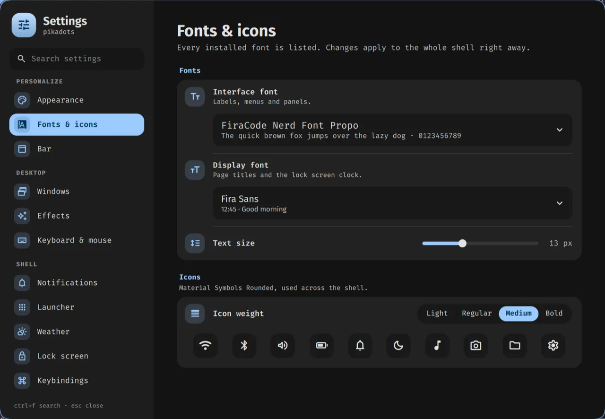

# The Settings app

**Super + ,** (comma) opens it; so do the gear at the bottom of the control center, "Settings" in
the launcher, and `qs ipc call settings open <page>` (page names below). It's a normal floating
window: categories on the left, one page at a time on the right. Everything applies at once.

**Search** (Ctrl + F) finds pages and individual settings: matching settings are listed first, and
Enter or a click opens the page, scrolls to the setting and highlights it. Esc clears the search,
then closes the window.

## Pages

| Page | `open` name | What's in it |
|---|---|---|
| Appearance | `appearance` | Wallpaper strip (click to apply and recolor), light/dark/auto mode, palette style (tonal, vivid, expressive, neutral, monochrome, …), current palette, bar and panel opacity |
| Fonts & icons | `fonts` | Interface font and display font (headings, lock clock) from every installed font, text size, icon weight |
| Bar | `bar` | Height, weather chip, music spectrum, 24-hour clock, seconds |
| Windows | `windows` | Tiling layout (dwindle, master, scrolling), gaps, border width, resize on borders, corner roundness and shape |
| Effects | `effects` | Blur (strength, passes, vibrancy), window opacity, dimming, shadows, animation speed and workspace switch style (the bar's workspace number animates the same way) |
| Keyboard & mouse | `input` | Keyboard layouts and options, key repeat, pointer speed and acceleration, focus follows mouse, touchpad, cursor theme and size |
| Notifications | `notifications` | Do Not Disturb, daily quiet hours, popup position, duration, count and width, test notification |
| Launcher | `launcher` | Columns, icon size, most used first, forget usage, each typed mode on or off |
| Weather | `weather` | °C/°F, bar chip, automatic location or city search |
| Lock screen | `lock` | Wallpaper blur, now playing, power buttons, rest delay |
| Keybindings | `keybinds` | Every shortcut, searchable; opens `keybinds.lua` |
| Network, Bluetooth, Sound, Displays | `network`, `bluetooth`, `sound`, `displays` | The control center's panels; Displays adds night light warmth |
| Power | `power` | Battery panel, idle timers (dim, lock, screen off, sleep), lock before sleep, keep awake |
| Default apps | `apps` | Browser, terminal, files, editor, email, pictures, videos, music, PDFs |
| Startup apps | `startup` | Apps and commands started at login |
| About | `about` | This machine and versions |

## Where choices are kept

Nothing in the repo changes; your choices stay on this machine:

| File | Written by | Read by |
|---|---|---|
| `~/.config/pikadots/settings.json` | the app (`quickshell/Settings.qml`) | the shell, `theme.sh` (mode, palette style), `idle.sh` (timers) |
| `~/.local/state/pikadots/hypr-settings.lua` | Windows, Effects, Keyboard & mouse (`quickshell/Hypr.qml`) | end of `hypr/settings.lua` |
| `~/.local/state/pikadots/autostart.lua` | Startup apps | end of the start handler in `hypr/autostart.lua` |
| `$XDG_RUNTIME_DIR/hypridle.conf` | `hypr/scripts/idle.sh` at login and after a change | hypridle (`hypridle.conf` in the repo shows the defaults) |
| `~/.config/xdg-terminals.list`, xdg-mime defaults | Default apps (`hypr/scripts/default-apps.py`) | `hypr/scripts/app.sh` |

Hyprland options only store what you changed: sections with changes show a **Reset** button, which
removes them and reloads Hyprland so `settings.lua`'s values come back. Deleting `settings.json`
(and the two `.lua` files) returns everything to the defaults.

## Fonts

The font lists show every font installed on the system. Nice UI fonts to try (not installed by
pikadots): Inter, Google Sans Flex, Rubik, Outfit, Manrope, Plus Jakarta Sans, Figtree, Geist. Put
`.ttf` files in `~/.local/share/fonts`, run `fc-cache -f`, then restart the shell
(`qs kill`, then `QS_ICON_THEME=Papirus-Dark setsid -f qs`) so it sees them.
