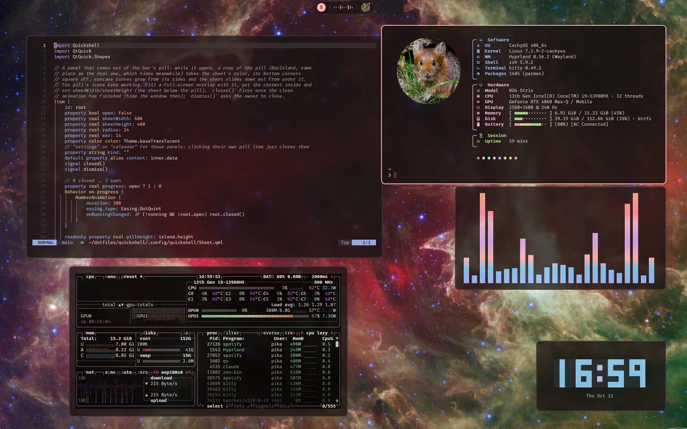
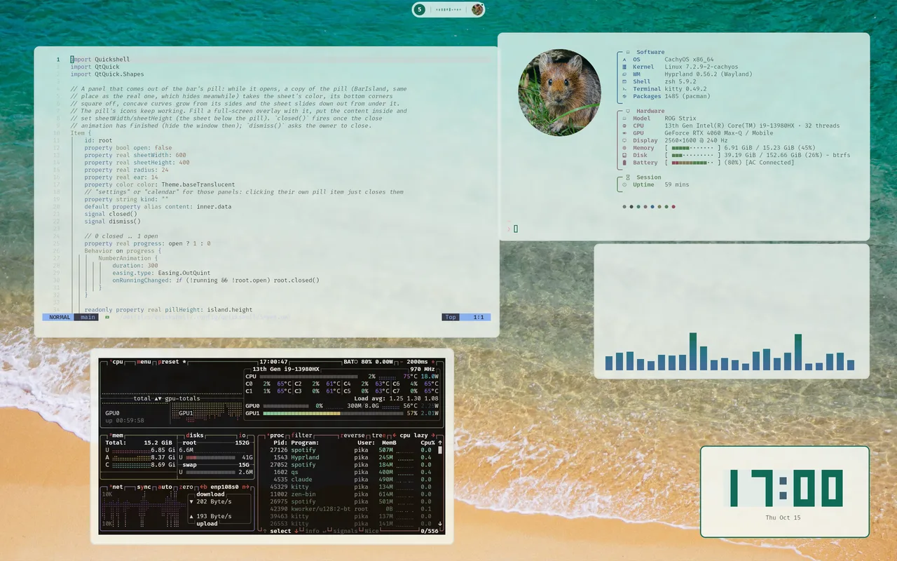
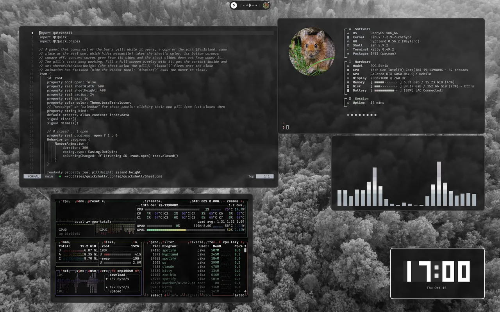

# Colors from the wallpaper

[← README](../README.md)

Picking a wallpaper (Super + Shift + W) runs `hypr/scripts/theme.sh <image>`. It sets the
wallpaper, generates colors with [matugen](https://github.com/InioX/matugen) from the templates in
`matugen/.config/matugen/templates/`, and reloads what's running. Run it without an argument to
regenerate from the current wallpaper. Generated files go to `~/.local/state/theme/`, outside the
repo. The chosen wallpaper is saved in `~/.config/hypr/wallpaper.conf`, which git ignores, so each
machine keeps its own; `hypr/scripts/hyprpaper.sh` starts hyprpaper with it and `hyprpaper.conf`.

## Light, dark and how colorful

`hypr/scripts/theme-palette.py` looks at the wallpaper first:

- **Bright wallpapers give a light theme**, others a dark one. GTK, icons, websites
  (`color-scheme`) and Neovim switch with it. The icon theme is the one picked in Settings > Fonts
  & icons (Papirus by default), in its light or dark variant.
- **The scheme follows how colorful it is**: black and white wallpapers give pure greys, muted ones
  a neutral theme, colorful ones a theme built from the wallpaper's own colors.
- **Terminal colors** keep their meaning (red is still red) but take the mode's lightness and the
  wallpaper's colorfulness, so they turn greyish on a grey wallpaper.

The thresholds are at the top of `main()` in that script.

| Colorful → dark | Bright → light | Black and white → grey |
|---|---|---|
|  |  |  |

## What gets recolored

| App | Updates |
|---|---|
| Bar, panels, launcher, notifications | Live |
| Hyprland borders | Live |
| kitty (and fastfetch, delta, lazygit) | Live |
| Neovim | Live |
| GTK apps (translucent, like kitty) | GTK3 live, GTK4 on restart |
| cava | Live |
| Firefox and Zen ([Pywalfox](#firefox-and-zen)) | Live |
| Keyboard lighting (ASUS) | Live |
| starship | Next prompt |
| fuzzel, peaclock | Next launch |
| Lock screen | Live |

Without generated files everything falls back to Catppuccin Mocha. To change which color goes
where, edit the template for that app.

## Firefox and Zen

**Firefox** follows the wallpaper live through the
[Pywalfox](https://addons.mozilla.org/firefox/addon/pywalfox/) extension. `pikadots install`
installs its helper (`python-pywalfox` from the AUR); add the extension once and restart Firefox.
matugen writes the colors to `~/.cache/wal/colors.json`, and `theme.sh` sends `pywalfox <mode>` and
`pywalfox update` to every open browser. The helper normally serves one browser at a time, so
pikadots starts it through `pywalfox-host`, which gives each browser its own socket in
`$XDG_RUNTIME_DIR/pywalfox/`.

**Zen** colors its sidebar, toolbar and workspace gradient itself and by default ignores Firefox
themes. pikadots turns themes on in each Zen profile (`zen.theme.disable-lightweight` in
`user.js`) and loads the generated `~/.local/state/theme/zen-userChrome.css` from
`chrome/userChrome.css`. That file points Zen's colors at Pywalfox's theme, so Zen also follows
the wallpaper live, light or dark, after a first restart. It replaces Zen's own space colors.
