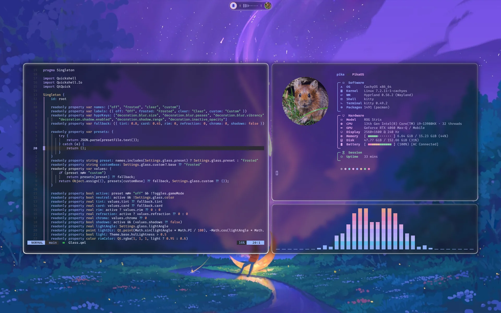
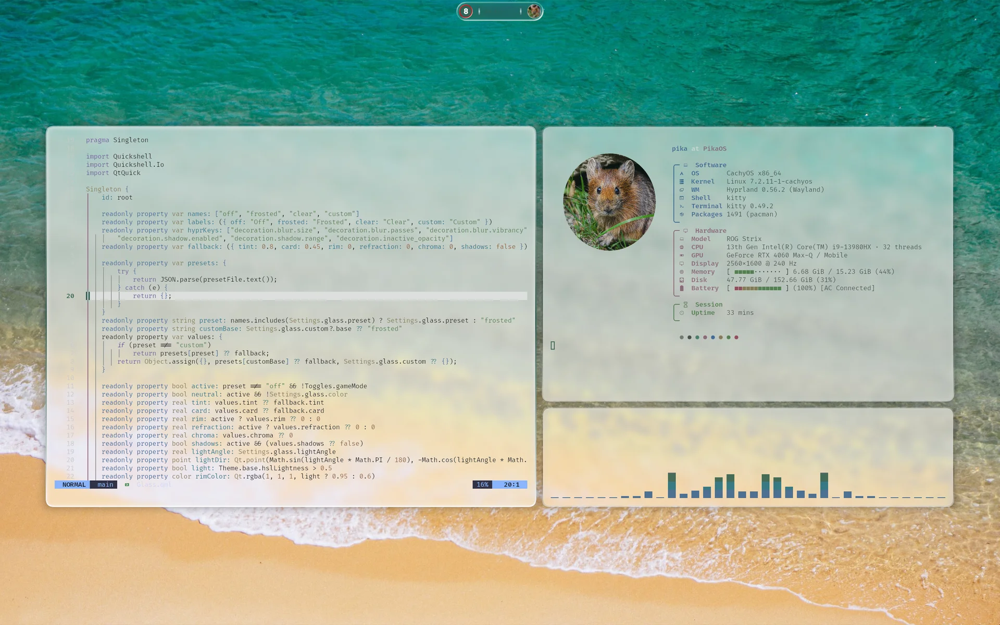
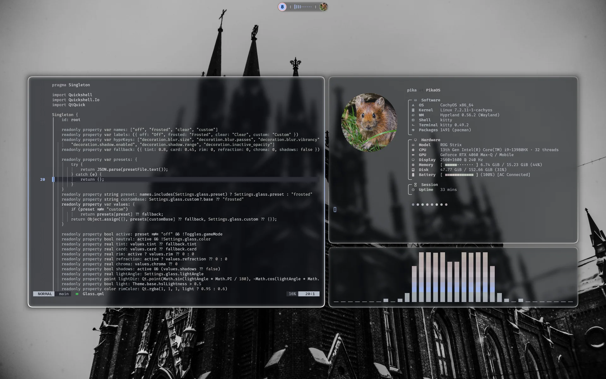
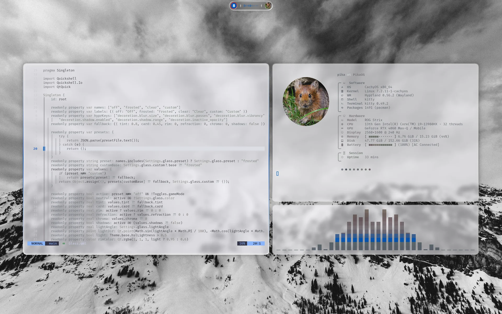
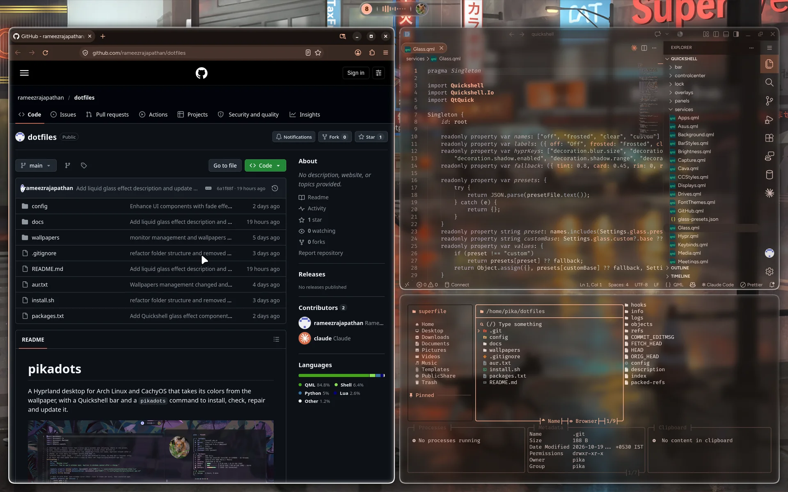

# Colors from the wallpaper

[← README](../README.md)

Picking a wallpaper (Super + Shift + W) runs `hypr/scripts/theme.sh <image>`. It sets the
wallpaper, generates colors with [matugen](https://github.com/InioX/matugen) from the templates in
`config/matugen/templates/`, and reloads what's running. Run it without an argument to
regenerate from the current wallpaper. Most generated files go to `~/.local/state/theme/`,
outside the repo; the rest go where their app looks (`config/matugen/config.toml` lists every
output): cava, btop and superfile themes in their config folders (`~/.config/cava/themes`,
`~/.config/btop/themes`, `~/.config/superfile/theme`), peaclock's `~/.peaclock/config` (overwritten
on each run), Pywalfox's `~/.cache/wal/colors.json`, the Neovim colorscheme in
`~/.local/share/nvim/site/colors/`, and `glass.lua` in `~/.local/state/pikadots/`
(written by `glass.py`, not matugen). The chosen wallpaper is saved in
`~/.config/hypr/wallpaper.conf`, which git ignores, so each machine keeps its own; `hypr/scripts/hyprpaper.sh` starts hyprpaper with it and `hyprpaper.conf`.

## Light, dark and how colorful

`hypr/scripts/theme-palette.py` looks at the wallpaper first:

- **Bright wallpapers give a light theme**, others a dark one. GTK, icons, websites
  (`color-scheme`) and the [Neovim colorscheme](#neovim) switch with it. The icon theme is the one picked in Settings > Fonts
  & icons (Papirus by default), in its light or dark variant.
- **The scheme follows how colorful it is**: black and white wallpapers give pure greys, muted ones
  a neutral theme, colorful ones a theme built from the wallpaper's own colors.
- **Terminal colors** keep their meaning (red is still red) but take the mode's lightness and the
  wallpaper's colorfulness, so they turn greyish on a grey wallpaper.

The thresholds are at the top of `main()` in that script. Settings > Appearance can override both:
Mode (auto, light, dark) and Palette style (auto, or a fixed scheme, including Multi-color, which
blends several of the wallpaper's colors). `theme.sh` passes them to the script as `THEME_MODE` and
`THEME_SCHEME`. While glass is on without Glass › Wallpaper color, the scheme is forced to
monochrome ([below](#liquid-glass)), unless game mode is on.

| Colorful → dark | Bright → light |
|---|---|
|  |  |
| **Black and white → grey** | **Bright black and white → light grey** |
|  |  |

## What gets recolored



| App | Updates |
|---|---|
| Bar, panels, launcher, notifications | Live |
| Hyprland borders | Live |
| kitty (and fastfetch, delta) | Live |
| Neovim ([`pikadots` colorscheme](#neovim), if your config uses it) | Live |
| GTK apps (translucent, like kitty) | GTK3 live, GTK4 on restart |
| Qt and KDE apps ([kdeglobals](#qt-and-kde-apps)) | Live |
| cava | Live |
| zsh: eza listings and completion menus ([terminal tools](#terminal-tools)) | Next prompt |
| lazygit ([terminal tools](#terminal-tools)) | Next start |
| btop (transparent, `color_theme = "wallpaper"`; USR2 reload) | Live |
| Firefox and Zen ([Pywalfox](#firefox-and-zen)) | Live |
| Thunderbird ([userChrome](#thunderbird)) | Next start |
| mpv (OSD, controls, console; [mpv](#mpv)) | Next start |
| VS Code and Code - OSS ([Pikadots theme](#vs-code-and-code---oss)) | Live |
| Keyboard lighting (ASUS) | Live |
| starship | Next prompt |
| fuzzel (colors, and the icon theme in its light or dark variant), peaclock, superfile (spf) | Next launch |
| Lock screen | Live; hyprlock, the fallback, on its next start |
| cmatrix (`~/.local/bin/cmatrix`, a wrapper that sets its green to the accent) | Next launch |
| Papirus folders (opt-in: Settings > Fonts & icons, [settings.md](settings.md#icons)) | Live, asks for your password when the color changes |
| Login screen and boot splash (opt-in: [`pikadots greeter` and `splash`](pikadots.md#login-screen-and-boot-splash)) | When you run the command again |
| Mouse cursor | Not recolored; pick a theme in Settings > Appearance > Cursor |
| Alacritty (optional: `~/.local/state/theme/alacritty.toml` is generated for you to import; pikadots doesn't set up Alacritty) | Next launch |

Before the first theme run, kitty, fuzzel, the shell, Hyprland borders and starship fall back to
Catppuccin Mocha, and zsh keeps its greys. GTK apps use plain adw-gtk3, and btop, cava and
superfile point at theme files that don't exist yet. To change which color goes where, edit the
template for that app.

The GTK 3 and 4 `gtk.css` files (`config/gtk`) import the generated
`~/.local/state/theme/gtk.css` by a relative path, so they work in any home folder.

## Liquid glass

One setting, **Settings › Appearance › Glass**, makes the shell, Hyprland and the apps translucent
together. Presets live in `quickshell/services/glass-presets.json`:

| Dark mode | Off | Frosted (default) | Clear |
|---|---|---|---|
| Bar and panels | 85% | 68% | 42% |
| GTK, VS Code, Zen windows | 70% | 80% | 62% |
| kitty | 85% | 80% | 62% |
| Rim light, refraction | none | soft | strong |
| Hyprland blur (size/passes), shadows | your Effects page | 8/3, on | 10/4, on |

In light mode, with glass on, the shell, cards, app windows and kitty are more opaque than this, so text stays
readable (`for_mode()` in `hypr/scripts/glass.py`). Custom starts from the current preset and shows
a slider for each value. Off is the look from before glass.

**Colorless by default.** While glass is on, everything is made of clear glass. `theme.sh` uses
the monochrome palette for the shell and every app, gradient accents are off, and selected items
(pills, toggles, tabs, today in the calendar, the workspace circle) are brighter glass with a rim
instead of an accent fill. Glass › **Wallpaper color** brings the wallpaper's palette back. Terminal
ANSI colors are kept either way.

**Pills everywhere.** Separators are short glass capsules that fade at both ends (`GlassDivider.qml`).
Cards, rows, fields and buttons get a light-facing rim (`GlassRim.qml`). In apps:

- kitty uses round powerline tabs;
- GTK buttons, entries and dropdowns are pills, and popovers, cards and menus get 18px corners with
  a rim;
- Code - OSS has pill tabs, buttons and inputs, and rounded rimmed widgets;
- btop, superfile and lualine already use rounded borders.

**In the shell.** Panels, the bar, the OSD, popups and lock screen cards are drawn by
`widgets/GlassSurface.qml`, which runs `shaders/glass.frag`. The shader finds each edge from the
shape itself, so pills, islands and sheets with ears all work. It adds:

- a 1px rim that is brightest where it faces the light (Light direction, 0° = above);
- a band along the edge that bends a soft copy of the wallpaper, with a slight color fringe;
- a soft shadow under drop-down sheets.

Hyprland blurs what is behind (`ignore_alpha 0.25` on `quickshell-*` layers). The edge band bends
the wallpaper, not the windows behind it, so it is kept narrow over windows. Cards, tiles and pills
inside panels use `GlassRim.qml` (a gradient stroke) and `Theme.glassFill()`. After editing the
shader, run `hypr/scripts/shaders.sh` (needs `qt6-shadertools`). The compiled `.qsb` is in the repo,
and `pikadots health` warns when it is older than the source.

**Everywhere else.** `theme.sh` (or `theme.sh --glass`, which the Settings app runs) calls
`hypr/scripts/glass.py`, which does two things:

- It adds `glass.*` values to matugen's input. The templates use them: GTK `alpha()` backgrounds and
  a headerbar highlight, kitty `background_opacity`, VS Code `pikadots.glass`, Zen's browser
  background (`color-mix`), fuzzel and hyprlock.
- It writes `~/.local/state/pikadots/glass.lua`: blur, vibrancy, noise, shadows, inactive opacity
  and window borders drawn as a colorless glass rim (a white gradient along the light direction)
  plus Hyprland's inner `glow` for a frosted edge. With Wallpaper color on, the active border
  also carries the accent. Scratchpad borders turn white too.
  `settings.lua` loads it before your Effects page values, so anything you set there still wins.
  Picking a preset clears your blur, shadow and inactive-opacity values so the preset shows.

Zen needs `zen.widget.linux.transparency` (written by `pikadots repair`) and a restart. Qt apps
only get the matching colors, because Qt widgets can't be translucent without Kvantum. Game mode
turns glass off. Rim and refraction stop, and Hyprland drops blur and shadows.

IPC: `qs ipc call glass preset off|frosted|clear|custom`, `qs ipc call glass cycle`.

## Qt and KDE apps

Qt apps only take a theme from `~/.config/kdeglobals`, the file Plasma uses too.
`hypr/scripts/kde-theme.py` writes the wallpaper's colors (from the matugen template `kde.json`),
the icon theme and, with "Use in apps", the fonts into it. Plasma's own values are saved to
`~/.local/state/pikadots/kdeglobals-plasma.json` first. `settings.lua` sets
`QT_QPA_PLATFORMTHEME=kde`, so non-KDE Qt apps (Qt Designer, OneDrive GUI, CachyOS tools) read it
as well.

`config/plasma/pikadots.sh`, linked to `~/.config/plasma-workspace/env/pikadots.sh`, puts Plasma's
values back whenever a Plasma session starts. The next Hyprland login applies the wallpaper colors again,
and saves Plasma's values again first, so a change made in Plasma's own settings is kept. Turning
off Settings > Appearance > "Qt and KDE apps" puts Plasma's values back right away.
`kde-theme.py restore` does the same by hand.

## Firefox and Zen

**Firefox** follows the wallpaper live through the
[Pywalfox](https://addons.mozilla.org/firefox/addon/pywalfox/) extension. `pikadots install`
installs its helper (`python-pywalfox` from the AUR); add the extension once and restart Firefox.
matugen writes the colors to `~/.cache/wal/colors.json`, and `theme.sh` sends `pywalfox <mode>` and
`pywalfox update` to every open browser. The helper normally serves one browser at a time, so
pikadots starts it through `pywalfox-host`, which gives each browser its own socket in
`$XDG_RUNTIME_DIR/pywalfox/`.

**Zen** colors its sidebar, toolbar and workspace gradient itself and by default ignores Firefox
themes. pikadots turns themes on in each Zen profile (`zen.theme.disable-lightweight` in
`user.js`) and loads the generated `~/.local/state/theme/zen-userChrome.css` from
`chrome/userChrome.css`. That file points Zen's colors at Pywalfox's theme, so Zen also follows
the wallpaper live, light or dark, after a first restart. It replaces Zen's own space colors.

## Thunderbird

Thunderbird is themed the same way as Zen: `pikadots install` and `repair` add the stylesheet
preference to `user.js` and an `@import` of the generated
`~/.local/state/theme/thunderbird-userChrome.css` (template `thunderbird-userChrome.css`) to
`chrome/userChrome.css` in each profile under `~/.config/thunderbird` or `~/.thunderbird`. Restart
Thunderbird once to see it. It only works with the default System theme, not with theme add-ons.

## Neovim

pikadots ships no Neovim config, only a colorscheme. matugen writes it (template
`nvim-colors.lua`) to `~/.local/share/nvim/site/colors/pikadots.lua`, which Neovim finds on its
own, so any config can use it:

```lua
vim.cmd.colorscheme("pikadots")   -- or :colorscheme pikadots
```

The background is transparent to match kitty. It covers Treesitter, LSP, diagnostics and common
plugins (GitSigns, Telescope, NvimTree, neo-tree, which-key, blink.cmp and nvim-cmp, lualine's
`auto` theme, and more). `theme.sh` re-applies it in running Neovims (their sockets in
`$XDG_RUNTIME_DIR/nvim.*.0`), but only in those that use it. With `nvim --clean`, add
`--cmd 'set rtp^=~/.local/share/nvim/site'`.

For a config built on Catppuccin, the template `nvim.lua` still writes a palette to
`~/.local/state/theme/nvim.lua` that can feed Catppuccin's color overrides.

## Terminal tools

- **zsh and eza**: matugen writes `~/.local/state/theme/zsh-colors.zsh` (eza's `EZA_COLORS` and
  the completion menu colors), which `.zshrc` sources. Open shells check the file's time before
  each prompt, so they pick up new colors at the next prompt. Without it, zsh keeps its greys.
- **lazygit**: `config/lazygit/config.yml` is linked to `~/.config/lazygit/config.yml`. Its colors
  and a light or dark delta pager come from `~/.local/state/theme/lazygit.yml`, added through
  `LG_CONFIG_FILE` in `.zshrc`, so lazygit is themed when started from zsh, with new colors on its
  next start. Diffs come in two views: delta's normal one and side by side; press `|` in lazygit
  to switch (`\` goes back). The theme file loads last, so a custom pager belongs in the template
  (`lazygit.yml`), not in `config.yml`.

## mpv

Only `config/mpv/mpv.conf` is linked to `~/.config/mpv/mpv.conf`; your `input.conf` and scripts
stay yours. It sets `hwdec=auto-safe`, `keep-open`, screenshots to `~/Pictures/Screenshots` and
Fira Sans, then includes `~/.local/state/theme/mpv.conf` (OSD, on-screen controls and console in
the wallpaper colors) and `~/.local/state/pikadots/mpv-font.conf` (the shell's interface font, from
Settings > Fonts & icons). Subtitles keep the dark scheme's colors in light mode too, so they stay
readable.

## VS Code and Code - OSS

`pikadots install` (or `repair`, after installing an editor) builds a small local theme extension,
"Pikadots", and installs it in each of Code - OSS, VS Code and VSCodium it finds
(`hypr/scripts/vscode-theme.py install`). The theme is the matugen template `vscode-theme.json`,
styled like kitty: one surface for every part with thin lines between them, the active tab
filled, and the same syntax and terminal colors as Neovim and kitty. Its themes use VS Code's
`_watch` flag, so `theme.sh` only copies the new file into the extension and open windows recolor
live. Light and dark follow the desktop (`window.autoDetectColorScheme`). The editor also gets
kitty's feel: the terminal font from Settings > Fonts, a block cursor that blinks softly and
glides, and 12px of padding.

**Transparency** (Code - OSS and VS Code): Arch's Code - OSS runs on the system Electron from a small
launcher, `/usr/lib/code/code.mjs`. `vscode-theme.py` writes a copy to
`~/.local/share/pikadots/code-oss/code.mjs` that opens windows transparent, clears the parts'
backgrounds and paints one tint under them (the theme's `pikadots.glass`, whose alpha is Glass's app windows value), so text
stays solid and Hyprland blurs the wallpaper behind. `~/.local/bin/code-oss` (and `code`) and
`~/.local/share/applications/code-oss.desktop` start it; they're rewritten on every theme change,
so a Code - OSS update is picked up.

Microsoft's VS Code bundles its own Electron, which always loads the app next to its binary, so
`vscode-theme.py` mirrors `/usr/share/code` into `~/.local/share/pikadots/vscode`: symlinks for
everything but the binary (a reflink copy, free on btrfs) and `resources/app/package.json`, whose
`main` points at `pikadots.mjs` (the same glass prelude, then VS Code's own `out/main.js`).
`~/.local/bin/code` and the two `com.microsoft.VSCode*.desktop` copies start it; when an update
changes the binary, `code` rebuilds the mirror first (or falls back to `/usr/bin/code`). VS Code's
"modern UI" paints its shell from `--modern-ui-*` variables, which are cleared too.
Restart the editor once after installing.

At login, `vscode-theme.py sync` (from `autostart.lua`) keeps this in step with what's installed:
an editor installed since gets the extension and its transparent launcher, and an uninstalled
one's launcher, desktop entry and mirror are removed, so `code` always opens an editor that exists.

The settings it replaced are kept in `~/.local/state/pikadots/vscode-<editor>.json`;
`vscode-theme.py restore` (also run by `pikadots uninstall`) puts them back, removes the extension
and the transparent launcher.
