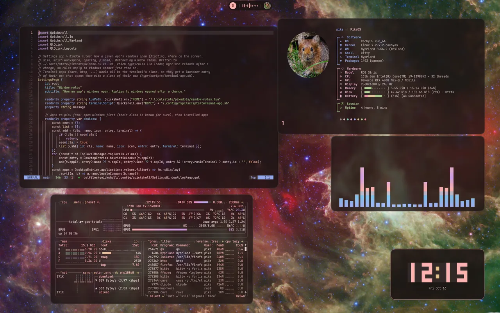
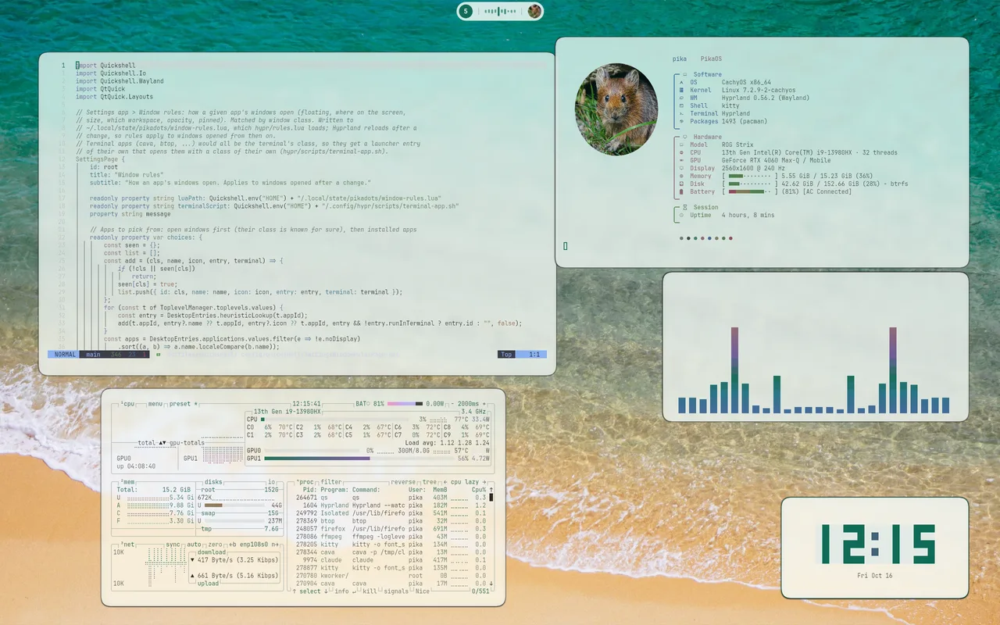
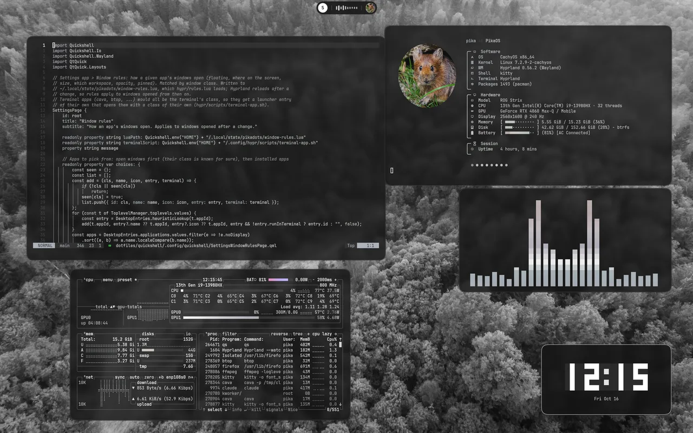
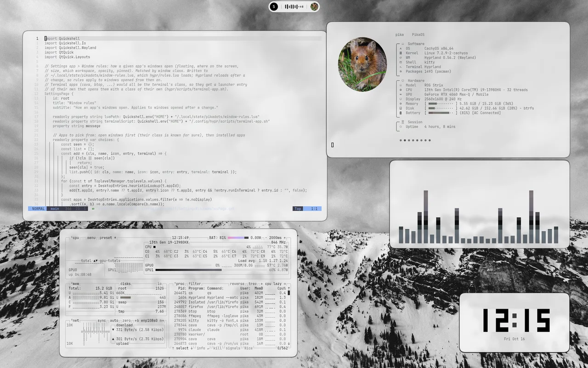
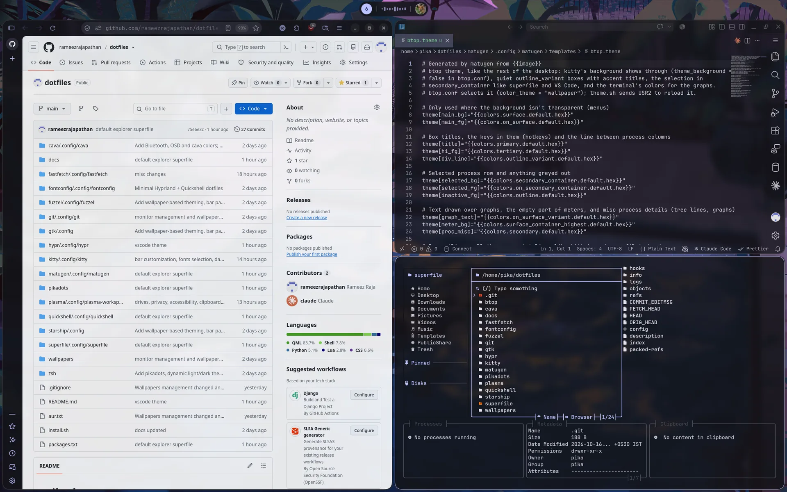

# Colors from the wallpaper

[← README](../README.md)

Picking a wallpaper (Super + Shift + W) runs `hypr/scripts/theme.sh <image>`. It sets the
wallpaper, generates colors with [matugen](https://github.com/InioX/matugen) from the templates in
`config/matugen/templates/`, and reloads what's running. Run it without an argument to
regenerate from the current wallpaper. Generated files go to `~/.local/state/theme/`, outside the
repo. The chosen wallpaper is saved in `~/.config/hypr/wallpaper.conf`, which git ignores, so each
machine keeps its own; `hypr/scripts/hyprpaper.sh` starts hyprpaper with it and `hyprpaper.conf`.

## Light, dark and how colorful

`hypr/scripts/theme-palette.py` looks at the wallpaper first:

- **Bright wallpapers give a light theme**, others a dark one. GTK, icons, websites
  (`color-scheme`) and Neovim switch with it. The icon theme is the one picked in Settings > Fonts
  & icons (Papirus by default), in its light or dark variant.
- **The scheme follows how colorful it is**: black and white wallpapers give pure greys, muted ones
  a neutral theme, colorful ones a theme built from the wallpaper's own colors.
- **Terminal colors** keep their meaning (red is still red) but take the mode's lightness and the
  wallpaper's colorfulness, so they turn greyish on a grey wallpaper.

The thresholds are at the top of `main()` in that script.

| Colorful → dark | Bright → light |
|---|---|
|  |  |
| **Black and white → grey** | **Bright black and white → light grey** |
|  |  |

## What gets recolored

| App | Updates |
|---|---|
| Bar, panels, launcher, notifications | Live |
| Hyprland borders | Live |
| kitty (and fastfetch, delta, lazygit) | Live |
| Neovim | Live |
| GTK apps (translucent, like kitty) | GTK3 live, GTK4 on restart |
| Qt and KDE apps ([kdeglobals](#qt-and-kde-apps)) | Live |
| cava | Live |
| btop (transparent, `color_theme = "wallpaper"`; USR2 reload) | Live |
| Firefox and Zen ([Pywalfox](#firefox-and-zen)) | Live |
| VS Code and Code - OSS ([Pikadots theme](#vs-code-and-code---oss)) | Live |
| Keyboard lighting (ASUS) | Live |
| starship | Next prompt |
| fuzzel, peaclock, superfile (spf) | Next launch |
| Lock screen | Live |

Without generated files everything falls back to Catppuccin Mocha. To change which color goes
where, edit the template for that app.

## Qt and KDE apps

Qt apps only take a theme from `~/.config/kdeglobals`, the file Plasma uses too.
`hypr/scripts/kde-theme.py` writes the wallpaper's colors (from the matugen template `kde.json`),
the icon theme and, with "Use in apps", the fonts into it. Plasma's own values are saved to
`~/.local/state/pikadots/kdeglobals-plasma.json` first. `settings.lua` sets
`QT_QPA_PLATFORMTHEME=kde`, so non-KDE Qt apps (Qt Designer, OneDrive GUI, CachyOS tools) read it
as well.

The `plasma` package adds `~/.config/plasma-workspace/env/pikadots.sh`, which puts Plasma's values
back whenever a Plasma session starts. The next Hyprland login applies the wallpaper colors again,
and saves Plasma's values again first, so a change made in Plasma's own settings is kept. Turning
off Settings > Appearance > "Qt and KDE apps" puts Plasma's values back right away.
`kde-theme.py restore` does the same by hand.

## Firefox and Zen

**Firefox** follows the wallpaper live through the
[Pywalfox](https://addons.mozilla.org/firefox/addon/pywalfox/) extension. `pikadots install`
installs its helper (`python-pywalfox` from the AUR); add the extension once and restart Firefox.
matugen writes the colors to `~/.cache/wal/colors.json`, and `theme.sh` sends `pywalfox <mode>` and
`pywalfox update` to every open browser. The helper normally serves one browser at a time, so
pikadots starts it through `pywalfox-host`, which gives each browser its own socket in
`$XDG_RUNTIME_DIR/pywalfox/`.

**Zen** colors its sidebar, toolbar and workspace gradient itself and by default ignores Firefox
themes. pikadots turns themes on in each Zen profile (`zen.theme.disable-lightweight` in
`user.js`) and loads the generated `~/.local/state/theme/zen-userChrome.css` from
`chrome/userChrome.css`. That file points Zen's colors at Pywalfox's theme, so Zen also follows
the wallpaper live, light or dark, after a first restart. It replaces Zen's own space colors.

## VS Code and Code - OSS

`pikadots install` (or `repair`, after installing an editor) builds a small local theme extension,
"Pikadots", and installs it in each of Code - OSS, VS Code and VSCodium it finds
(`hypr/scripts/vscode-theme.py install`). The theme is the matugen template `vscode-theme.json`,
styled like kitty: one surface for every part with thin lines between them, the active tab
filled, and the same syntax and terminal colors as Neovim and kitty. Its themes use VS Code's
`_watch` flag, so `theme.sh` only copies the new file into the extension and open windows recolor
live. Light and dark follow the desktop (`window.autoDetectColorScheme`). The editor also gets
kitty's feel: the terminal font from Settings > Fonts, a block cursor that blinks softly and
glides, and 12px of padding.

**Transparency** (Code - OSS only): Arch's Code - OSS runs on the system Electron from a small
launcher, `/usr/lib/code/code.mjs`. `vscode-theme.py` writes a copy to
`~/.local/share/pikadots/code-oss/code.mjs` that opens windows transparent, clears the parts'
backgrounds and paints one tint under them (the theme's `pikadots.glass`, kitty's 0.85), so text
stays solid and Hyprland blurs the wallpaper behind. `~/.local/bin/code-oss` (and `code`) and
`~/.local/share/applications/code-oss.desktop` start it; they're rewritten on every theme change,
so a Code - OSS update is picked up. Microsoft's VS Code bundles its own Electron and stays opaque.
Restart Code - OSS once after installing.

The settings it replaced are kept in `~/.local/state/pikadots/vscode-<editor>.json`;
`vscode-theme.py restore` (also run by `pikadots uninstall`) puts them back, removes the extension
and the transparent launcher.
